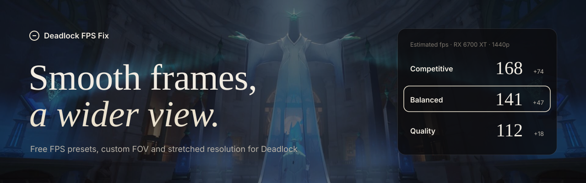
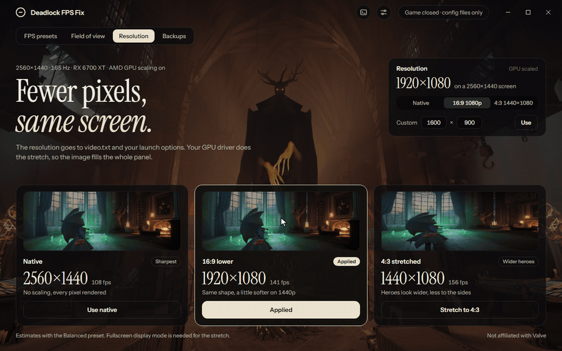
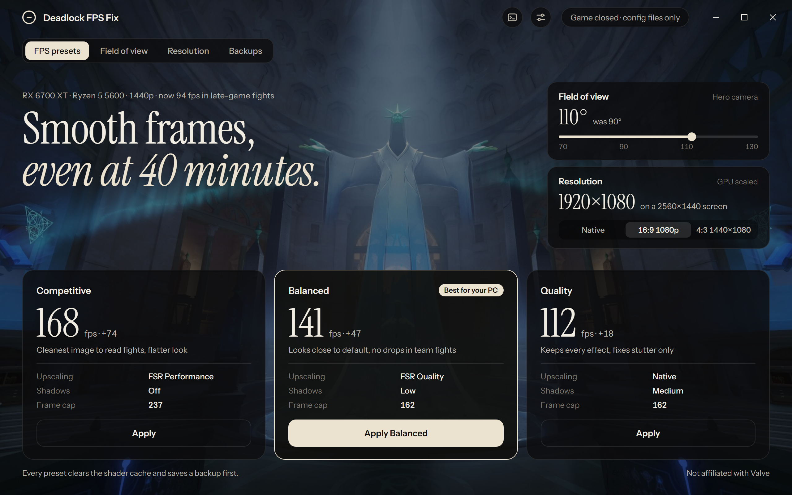
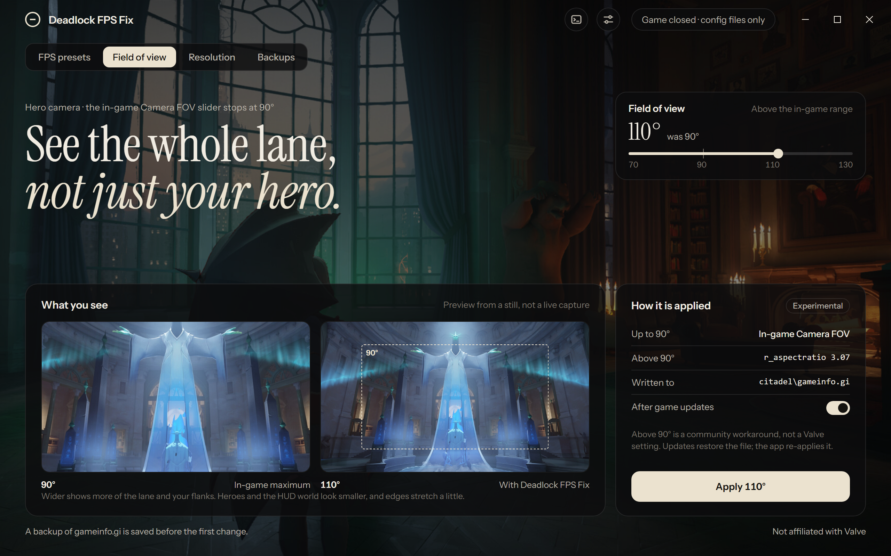
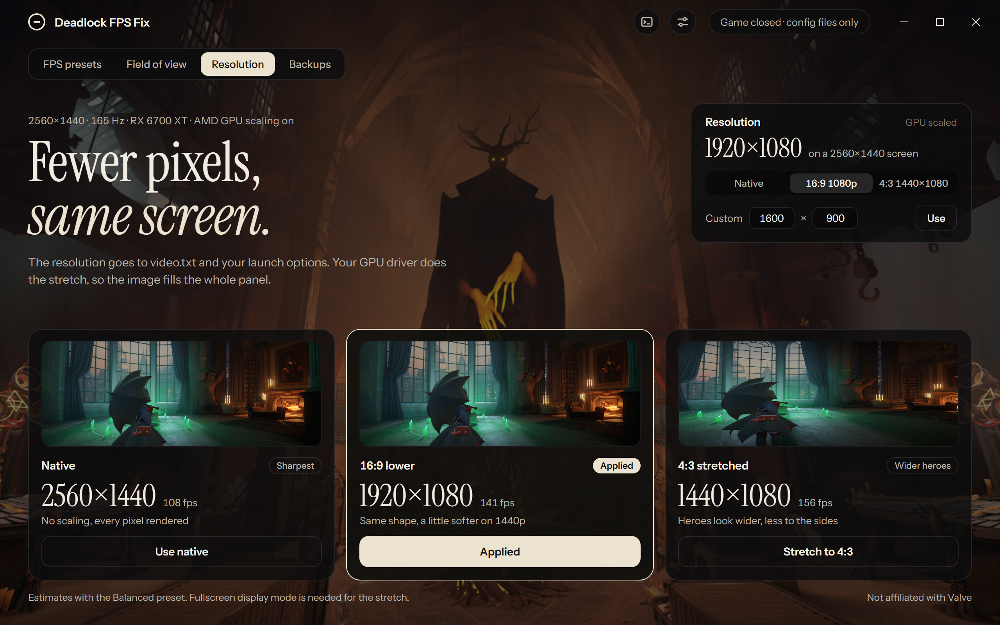
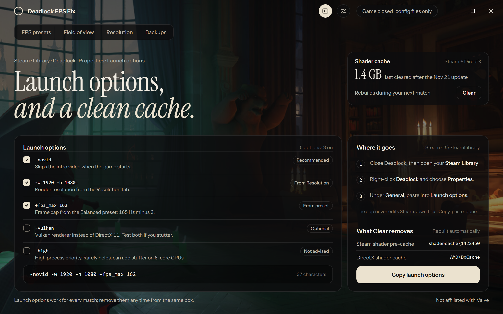
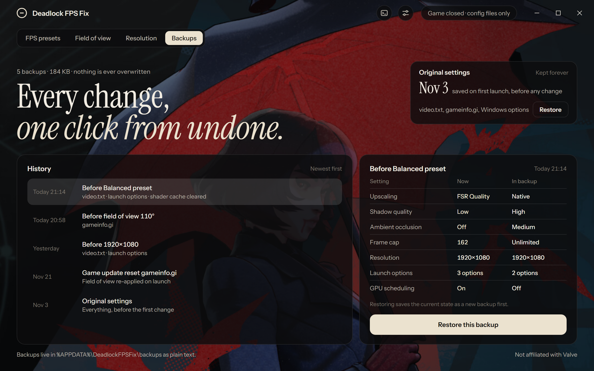
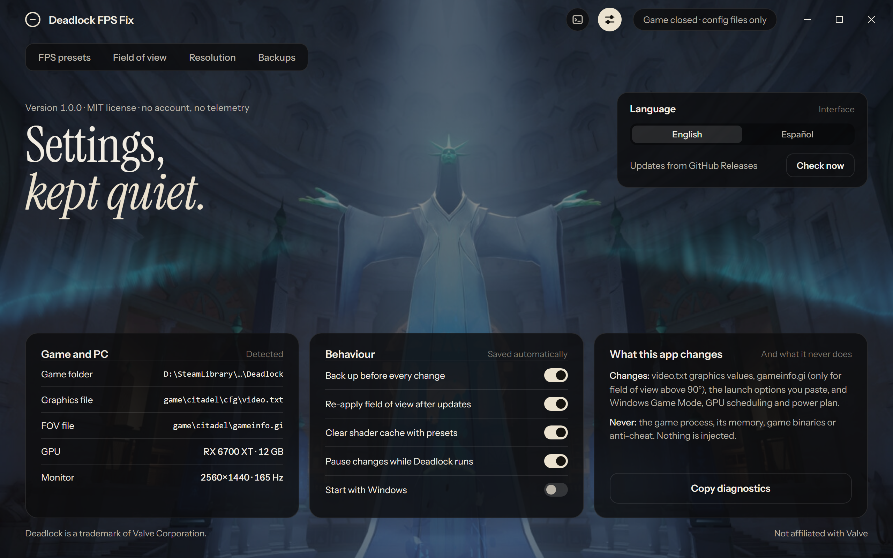

<h1>Deadlock FPS Fix: aumentar FPS en Deadlock, cambiar el FOV y usar resolución estirada, gratis</h1>

<i>Deadlock FPS Fix es un programa gratis y de código abierto para aumentar FPS en Deadlock y ajustar su configuración en Windows 10 y 11: aplica presets de FPS estimados para tu PC, pone un campo de visión personalizado y una resolución estirada o más baja, y borra la caché de shaders para quitar los tirones. Hecho para Deadlock de Valve, elige la <b>mejor configuración de Deadlock para tu PC</b>, maneja un <b>campo de visión (FOV) personalizado</b> (por encima de 90° es experimental) y una <b>resolución estirada o más baja</b>, y hace una copia de seguridad de cada archivo antes de tocar nada.</i>

<a href="README.md">English</a> · <b>Español</b> · <a href="README.ar.md">العربية</a> · <a href="README.hi.md">हिन्दी</a> · <a href="README.zh-CN.md">简体中文</a>
 
<a href="#fotogramas">Fotogramas</a> ·
<a href="#campo-de-vision">Campo de visión</a> ·
<a href="#resolucion">Resolución</a> ·
<a href="#los-presets-lado-a-lado">Presets</a> ·
<a href="#fotos-fijas">Capturas</a> ·
<a href="#accion-descarga-y-primeros-pasos">Descarga</a> ·
<a href="#preguntas-frecuentes">Preguntas</a>

 

> En la primera línea, Deadlock va fluido. Cuarenta minutos después, con seis héroes, definitivas y almas por todos lados en la misma pelea, ya no tanto. Deadlock FPS Fix está pensado para ese momento. Son tres capítulos cortos: **fotogramas**, **campo de visión** y **resolución**. Nada más.

## De un vistazo

| | |
|---|---|
| **Qué es** | Una app de Windows que sube los FPS y quita los tirones en Deadlock de Valve con presets, campo de visión y resolución |
| **Precio y licencia** | Gratis, código abierto con licencia MIT. Sin cuenta, sin anuncios, sin telemetría |
| **Plataformas** | Windows 10 (21H2 o posterior) y Windows 11 de 64 bits, Deadlock instalado con Steam. Sin Linux ni Steam Deck en la 1.0 |
| **Datos** | Solo se conecta a internet para buscar actualizaciones en GitHub Releases, y puedes desactivarlo |
| **Funciones principales** | Tres presets con FPS estimados · deslizador de FOV con vista previa · resolución nativa, 16:9 o 4:3 estirada · borrar caché de shaders · opciones de lanzamiento · copias y restauración en un clic |
| **Qué cambia** | `video.txt`, `gameinfo.gi` (solo para un FOV por encima de 90°), las opciones de lanzamiento que pegas en Steam, las carpetas de caché de shaders y, en Windows, el Modo de juego, la programación de GPU y el plan de energía |
| **Qué nunca toca** | El proceso del juego ni su memoria, ejecutables, mapas y archivos del juego, tu cuenta de Steam |
| **Anticheat** | Deadlock usa VAC. No se inyecta nada ni se lee memoria. El FOV por encima de 90° es un método experimental y no oficial de la comunidad que Valve puede cambiar o bloquear; para el menor riesgo, deja el FOV en 90° o menos. No podemos prometer nada en nombre de Valve |
| **Alternativa a** | El menú de opciones del juego (FOV hasta 90°), editar archivos a mano, optimizadores de juegos genéricos |

 

<h2 align="center">CAPÍTULO I Fotogramas</h2>

<i>Tres presets. Uno de ellos es el indicado para tu PC, y la app te dice cuál.</i>

Deadlock FPS Fix detecta tu tarjeta gráfica, tu procesador y tu monitor, y estima los FPS de tres presets en **peleas de equipo de final de partida**, que es donde las caídas de FPS en Deadlock de verdad molestan. **Competitivo** deja la imagen limpia y plana para leer bien las peleas. **Equilibrado** se ve casi como el valor por defecto y elimina las caídas. **Calidad** mantiene todos los efectos y solo quita los tirones. Antes de aplicar uno, la app guarda una copia de seguridad, borra la caché de shaders y escribe los valores en el propio `video.txt` del juego.

 <i>Aplicar Equilibrado: copia de seguridad, caché de shaders, video.txt y opciones de lanzamiento. Después, reinicia Deadlock.</i>

 

<h2 align="center">CAPÍTULO II Campo de visión</h2>

<i>El control Camera FOV del juego llega hasta 90°. A veces quieres ver la línea entera.</i>

Mueve el deslizador y la vista previa te muestra lo que ve la cámara del héroe, al lado del máximo del juego. **Hasta 90°** la app usa el mismo valor que el control Camera FOV del juego. **Por encima de 90°** usa el método de la comunidad: un valor `r_aspectratio` en `game\citadel\gameinfo.gi` (unos `3.07` para 110°). Esa parte es **experimental**: no es un ajuste oficial de Valve, cada actualización del juego restaura el archivo original y la app lo vuelve a aplicar en el siguiente inicio si así lo quieres. Antes del primer cambio se guarda una copia del archivo.

 <i>Por encima de 90°, el marco punteado muestra lo que se vería con el máximo del juego.</i>

 

<h2 align="center">CAPÍTULO III Resolución</h2>

<i>Menos píxeles, la misma pantalla.</i>

Elige **Nativa**, una resolución **16:9** más baja (por ejemplo 1920×1080 en un monitor 1440p), **4:3 estirada** (1440×1080 o 1280×960) o escribe un tamaño a medida. La app guarda la resolución en `video.txt` y añade `-w` y `-h` a tus opciones de lanzamiento. El estirado en sí lo hace el **driver de tu tarjeta gráfica**: la app revisa si el escalado por GPU está activo y te indica dónde activarlo (AMD Software: *Escalado de GPU* y *Modo de escalado: Panel completo*; Panel de control de NVIDIA: escalado a *Pantalla completa* en la GPU). La resolución estirada en Deadlock necesita el modo Pantalla completa, y algunos jugadores reportan que en 4:3 se cortan elementos del HUD en los bordes.

 <i>FPS estimados con el preset Equilibrado en el PC de prueba: 108 en nativa, 141 en 1080p, 156 en 4:3.</i>

 

## Los presets, lado a lado

Estimaciones en el PC de prueba (RX 6700 XT, Ryzen 5 5600, 2560×1440 a 165 Hz, peleas de final de partida, 94 FPS antes). Tus números serán distintos; la app los estima para tu hardware.

| | Competitivo | **Equilibrado** | Calidad |
|---|:---:|:---:|:---:|
| FPS estimados | **168** (+74) | **141** (+47) | **112** (+18) |
| Escalado | FSR Rendimiento | FSR Calidad | Nativo |
| Sombras | No | Bajas | Medias |
| Oclusión ambiental | No | No | Media |
| Límite de FPS | 237 | 162 | 162 |
| Aspecto | Plano y limpio | Casi como por defecto | Todos los efectos |
| Elígelo si | Juegas ranked y quieres el máximo de FPS | No quieres caídas en las peleas | Tu PC es potente y solo quieres quitar el lag y los tirones |

Los tres borran la caché de shaders y guardan una copia antes. El campo de visión y la resolución van aparte y funcionan con cualquier preset.

## Fotos fijas

<table>
<tr>
<td width="33%"> <b>Presets de FPS.</b> FPS estimados para tu PC.</td>
<td width="33%"> <b>Campo de visión.</b> 90° junto a tu valor.</td>
<td width="33%"> <b>Resolución.</b> Nativa, 16:9 o 4:3 estirada.</td>
</tr>
<tr>
<td width="33%"> <b>Opciones de lanzamiento.</b> Y una caché de shaders limpia.</td>
<td width="33%"> <b>Copias.</b> Cada cambio, a un clic de deshacerse.</td>
<td width="33%"> <b>Ajustes.</b> Lo que cambia y lo que nunca hace.</td>
</tr>
</table>

## Lo que cambia y lo que nunca toca

| Cambia | Nunca toca |
|---|---|
| `game\citadel\cfg\video.txt` (gráficos y resolución) | El proceso del juego ni su memoria |
| `game\citadel\gameinfo.gi`, solo para un FOV por encima de 90° | Ejecutables, mapas u otros archivos del juego |
| Opciones de lanzamiento, que tú mismo pegas en Steam | El anticheat (Deadlock usa VAC) |
| Carpetas de caché de shaders (precarga de Steam y caché de DirectX) | Tu cuenta de Steam ni los archivos de Steam |
| Windows: Modo de juego, programación de GPU acelerada por hardware, plan de energía | Nada sin hacer una copia antes |

No se inyecta nada: no hay overlay, ni driver, ni servicio en segundo plano. Todo lo que hace la app lo podrías hacer a mano con un editor de texto y la configuración de Windows; la app solo lo hace más rápido y guarda copias.

## Acción: descarga y primeros pasos

| Paquete | Archivo | Notas |
|---|---|---|
| Instalador | [`DeadlockFPSFix-Setup-1.0.0-x64.exe`](https://github.com/Dragonclavelocity/deadlock-fps-fix/releases/latest/download/deadlock-fps-fix.zip) | Acceso en el menú Inicio, se actualiza desde GitHub Releases |
| Portable | [`DeadlockFPSFix-1.0.0-portable-x64.zip`](https://github.com/Dragonclavelocity/deadlock-fps-fix/releases/latest/download/deadlock-fps-fix.zip) | Descomprime y ejecuta, la configuración queda en la carpeta |
| winget | `winget install DeadlockFPSFix.DeadlockFPSFix` | Cuando el paquete sea aceptado |
| Scoop | `scoop install extras/deadlock-fps-fix` | Cuando el paquete sea aceptado |

**Requisitos:** Windows 10 (21H2 o posterior) o Windows 11 de 64 bits y Deadlock instalado con Steam. Ocupa unos 15 MB.

1. **Cierra Deadlock** y abre Deadlock FPS Fix. Encuentra solo tu biblioteca de Steam y el archivo `video.txt`.
2. **Aplica el preset** marcado como *Ideal para tu PC*. Si quieres, ajusta después el campo de visión y la resolución.
3. **Pega las opciones de lanzamiento** en Steam (Biblioteca → clic derecho en Deadlock → Propiedades → General → Opciones de lanzamiento) y entra a una partida.

Descarga solo desde [GitHub Releases](https://github.com/Dragonclavelocity/deadlock-fps-fix/releases), con sumas SHA-256.

## Otras formas de hacerlo

Según lo que vimos al momento de escribir esto; revisa cada opción tú mismo, porque cambian.

| | Deadlock FPS Fix | Menú de opciones del juego | Editar archivos a mano | Optimizadores de juegos genéricos |
|---|:---:|:---:|:---:|:---:|
| Precio | Gratis, MIT | Gratis | Gratis | A menudo gratis con planes de pago |
| Presets pensados para Deadlock | ✅ | ❌ | ❌ | Normalmente ❌ |
| FOV por encima de 90° | ✅ experimental | ❌ (máx. 90°) | ✅ si conoces el archivo | ❌ |
| Guía de resolución estirada | ✅ | En parte | ✅ | ❌ |
| Borrar caché de shaders | ✅ | ❌ | ✅ a mano | A veces |
| Copia antes de cada cambio | ✅ | ❌ | Solo si la haces tú | Depende |
| Código abierto | ✅ | n/a | n/a | Normalmente ❌ |

Si buscabas una alternativa gratis a los optimizadores genéricos que conozca los archivos propios de Deadlock, es esta.

## Escenas

**Aumentar FPS en Deadlock con un PC de bajos recursos.** Empieza con Competitivo y luego prueba 16:9 a 1600×900. Borrar la caché de shaders después de un parche grande muchas veces quita por sí solo los tirones de la primera partida.

**Quitar los tirones de Deadlock después de una actualización.** Las actualizaciones traen shaders nuevos y a veces restauran archivos. Borra la caché una vez, juega una partida para que se reconstruya y revisa la pestaña Copias: la app anota cuándo una actualización restauró `gameinfo.gi` y vuelve a poner tu campo de visión.

**La mejor configuración de Deadlock para ranked.** Competitivo con el límite de FPS en tu frecuencia de refresco menos 3, o 237 en un monitor de 240 Hz. Desactivar las sombras ayuda a ver mejor, no solo a ganar FPS.

**Deadlock FOV por encima de 90.** Pestaña Campo de visión, entre 100 y 115°. Antes, lee la nota sobre el método de la comunidad.

**Resolución estirada 4:3 en Deadlock.** Pestaña Resolución, 4:3, y luego activa el escalado a panel completo en el driver. Pon Deadlock en Pantalla completa.

## Preguntas frecuentes

<b>¿Cómo cambio el FOV en Deadlock por encima de 90?</b>

Solo con un método no oficial de la comunidad, porque el control Camera FOV del juego llega hasta 90°. Ese método es un valor `r_aspectratio` en el bloque `ConVars` de `game\citadel\gameinfo.gi`; Deadlock FPS Fix lo escribe por ti a partir de los grados que elijas, con copia de seguridad. Es experimental, Valve puede cambiarlo o bloquearlo, y cada actualización del juego restaura el archivo original (la app puede volver a aplicarlo al iniciar). Si prefieres quedarte solo con ajustes oficiales, deja el deslizador en 90° o menos.

<b>¿Cómo pongo resolución estirada en Deadlock?</b>

Elige una resolución 4:3 como 1440×1080 o 1280×960 (la app la escribe en `video.txt` y en las opciones `-w`/`-h`), pon Deadlock en Pantalla completa y activa el escalado a pantalla completa por GPU en AMD Software o en el Panel de control de NVIDIA. Sin escalado por GPU verás barras negras en vez de la imagen estirada. Si una resolución no aparece en la lista, créala primero como resolución personalizada en el driver.

<b>¿Me pueden banear por usar Deadlock FPS Fix?</b>

No podemos prometer nada en nombre de Valve, pero la app solo cambia archivos de configuración, te da opciones de lanzamiento y modifica algunas opciones de Windows. No toca el proceso del juego, no lee su memoria y no inyecta nada, que es lo que busca VAC. El FOV por encima de 90° edita un archivo de configuración de texto en la carpeta del juego: es un truco experimental de la comunidad, no un ajuste oficial. Para el menor riesgo, usa solo los presets y deja el FOV en 90° o menos.

<b>¿Cuál es la mejor configuración de Deadlock para tener más FPS?</b>

Para la mayoría de los PC: escalado FSR (Calidad en tarjetas de gama media, Rendimiento en las más viejas), sombras bajas o desactivadas, oclusión ambiental desactivada, V-Sync desactivado y límite de FPS en tu frecuencia de refresco menos 3. La app elige el preset para tu hardware y te muestra la estimación antes de aplicarlo.

<b>¿Por qué Deadlock da tirones? ¿Sirve borrar la caché de shaders?</b>

Sobre todo porque los shaders se compilan mientras juegas, en especial después de una actualización o de cambiar de driver, y sí, borrar la caché de shaders suele ayudar. Al borrar la precarga de shaders de Steam y la caché de DirectX, el juego los vuelve a generar; la primera partida puede dar algún tirón y después suele ir más fluido que antes. No arregla el lag del servidor ni un PC que se sobrecalienta.

<b>¿Dónde está el archivo video.txt de Deadlock?</b>

`<biblioteca de Steam>\steamapps\common\Deadlock\game\citadel\cfg\video.txt`. La app lo encuentra sola y muestra la ruta en Ajustes.

<b>¿Qué opciones de lanzamiento uso en Deadlock?</b>

`-novid` para saltar el video de inicio, `-w` y `-h` si juegas con una resolución más baja o estirada, y `+fps_max` para limitar los FPS. `-high` casi nunca ayuda. `-vulkan` cambia el renderizador; pruébalo solo si DirectX 11 te da tirones, y compara.

<b>¿Cómo deshago todo?</b>

Abre Copias, elige *Configuración original* y pulsa Restaurar. Se guardó la primera vez que abriste la app, antes de cualquier cambio. Las opciones de lanzamiento las quitas tú en Steam.

<b>¿Es gratis? ¿Recoge datos?</b>

Sí, es gratis y de código abierto con licencia MIT, y no recoge datos: sin cuenta, sin anuncios y sin telemetría. Solo se conecta a internet para buscar actualizaciones en GitHub Releases, y puedes desactivarlo.

<b>¿Funciona en Linux o en Steam Deck?</b>

En la versión 1.0, no: es una app para Windows. El soporte para Linux (prefijos de Proton) está en la hoja de ruta.

## Hoja de ruta

- [x] Tres presets con FPS estimados para tu hardware
- [x] Deslizador de campo de visión con vista previa (rango del juego y experimental por encima de 90°)
- [x] Resolución nativa, 16:9 y 4:3 estirada, tamaños a medida
- [x] Borrar caché de shaders, opciones de lanzamiento, copias y restauración
- [x] Interfaz en inglés y español
- [ ] Benchmark corto dentro del juego (tiempos de fotograma con PresentMon)
- [ ] Perfiles de campo de visión por héroe
- [ ] Soporte para Linux y Steam Deck (Proton)
- [ ] Más idiomas de la interfaz (portugués, árabe, hindi, chino)

## Hecho con

## Contribuir

Los reportes de errores, los presets nuevos y las traducciones son bienvenidos. Lee primero [CONTRIBUTING.md](CONTRIBUTING.md) (en inglés): cada cambio debe poder deshacerse y limitarse a archivos de configuración, opciones de lanzamiento u opciones de Windows. Los problemas de seguridad se reportan como indica [SECURITY.md](SECURITY.md).

## Licencia y aviso legal

MIT, ver [LICENSE](LICENSE).

Deadlock FPS Fix es un proyecto independiente hecho por fans. **No está afiliado, respaldado ni patrocinado por Valve Corporation**. Deadlock, Steam y VAC son marcas comerciales de Valve Corporation. Las capturas del juego de este repositorio son imágenes promocionales de Valve tomadas de la página de Deadlock en Steam y se usan solo como ilustración. Los FPS son estimaciones y dependen de tu hardware, tus drivers y la partida.

 

Si Deadlock FPS Fix te dio una partida más fluida, <b>⭐ dale una estrella al repo</b> para que otros jugadores lo encuentren.

Palabras clave: aumentar fps deadlock, deadlock fps fix, mejor configuración deadlock, deadlock fov, cambiar fov deadlock, resolución estirada deadlock, deadlock 4:3, quitar lag deadlock, quitar tirones deadlock, caché de shaders deadlock, opciones de lanzamiento deadlock

