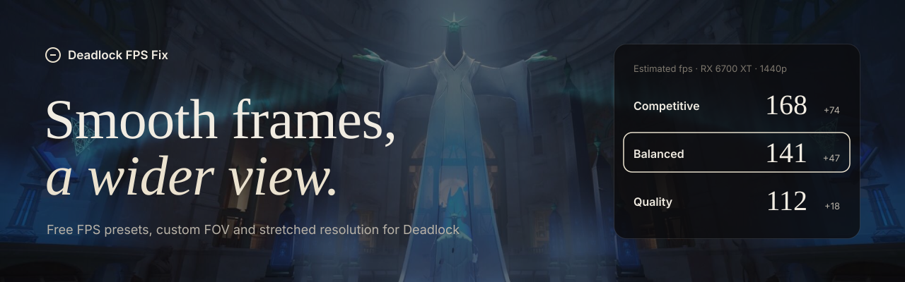
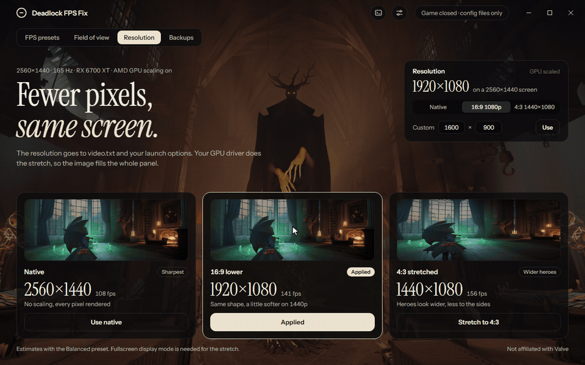
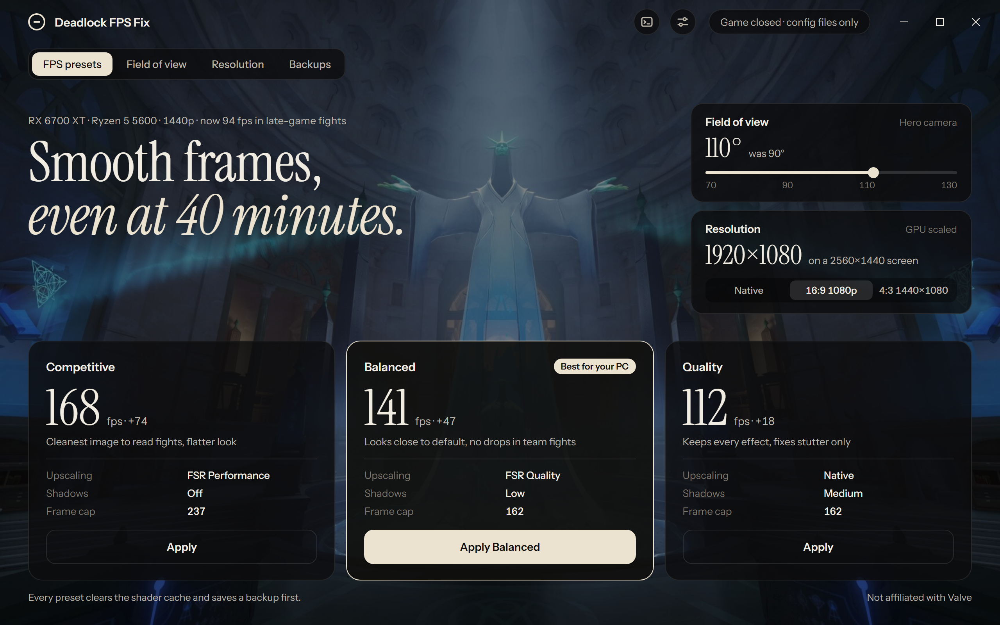
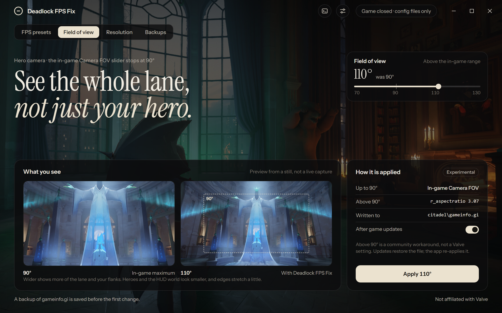
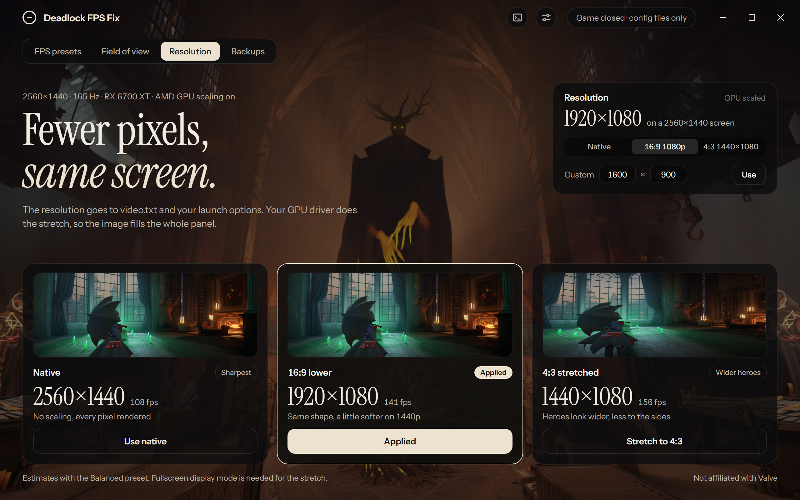
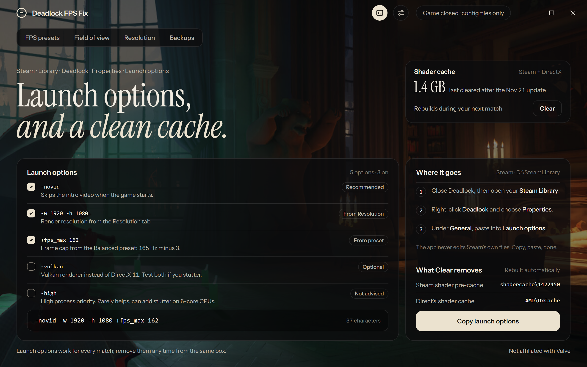
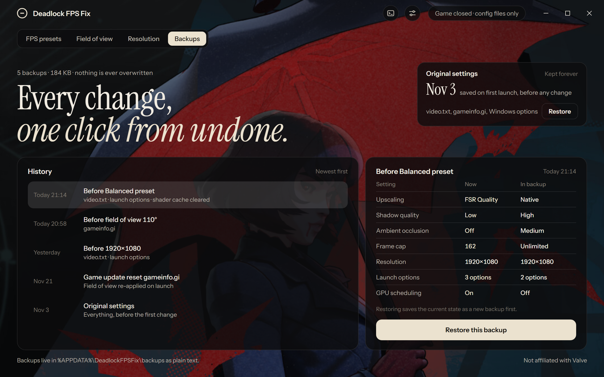
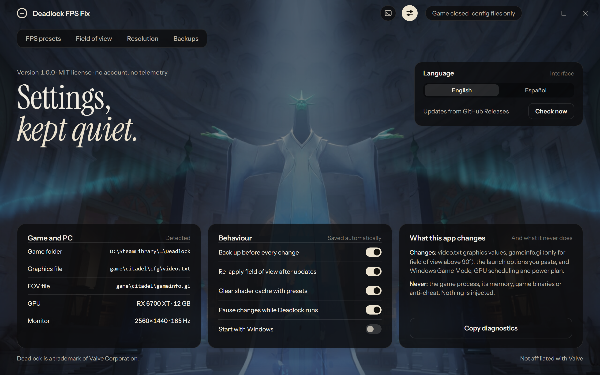

<h1>Deadlock FPS Fix: मुफ़्त Deadlock FPS boost, FOV changer और stretched resolution</h1>

<i>Deadlock FPS Fix, Windows 10 और 11 के लिए एक मुफ़्त, open-source Deadlock FPS boost और settings tool है, जो आपके PC के हिसाब से अनुमानित FPS presets लगाता है, custom field of view और stretched या कम resolution सेट करता है, और stutter ठीक करने के लिए shader cache साफ़ करता है। Valve के Deadlock के लिए बना यह tool <b>आपके PC के लिए Deadlock की सबसे अच्छी settings</b> चुनता है, <b>custom field of view</b> (90° से ऊपर experimental है) और <b>stretched या कम resolution</b> संभालता है, और कुछ भी बदलने से पहले हर file का backup लेता है।</i>

<a href="README.md">English</a> · <a href="README.es.md">Español</a> · <a href="README.ar.md">العربية</a> · <b>हिन्दी</b> · <a href="README.zh-CN.md">简体中文</a>
 
<a href="#frames">फ़्रेम्स</a> ·
<a href="#field-of-view">फ़ील्ड ऑफ़ व्यू</a> ·
<a href="#resolution">रेज़ोल्यूशन</a> ·
<a href="#the-presets-side-by-side">Presets</a> ·
<a href="#stills">स्क्रीनशॉट्स</a> ·
<a href="#roll-camera-download-and-quick-start">Download</a> ·
<a href="#faq">FAQ</a>

 

> पहली lane में Deadlock बढ़िया चलता है। चालीस मिनट बाद, जब एक ही fight में छह heroes, ult effects और हर तरफ़ souls हों, तब नहीं चलता। Deadlock FPS Fix उसी पल के लिए है। इसमें तीन छोटे अध्याय हैं: **फ़्रेम्स**, **field of view** और **resolution**। बस, और कुछ नहीं।

## एक नज़र में

| | |
|---|---|
| **यह क्या है** | एक Windows app जो presets, field of view और resolution settings के ज़रिए Valve के Deadlock में FPS बढ़ाता है और stutter ठीक करता है |
| **कीमत और license** | मुफ़्त, MIT के तहत open source। न account, न ads, न telemetry |
| **Platforms** | Windows 10 (21H2+) और Windows 11, 64-bit, Steam से install किया हुआ Deadlock। 1.0 में Linux या Steam Deck नहीं |
| **Data** | सिर्फ़ updates के लिए GitHub Releases check करने को online जाता है, और आप इसे बंद कर सकते हैं |
| **मुख्य features** | अनुमानित fps के साथ तीन presets · preview के साथ FOV slider · native, 16:9 या 4:3 stretched resolution · shader cache clear · launch options · backups और one-click restore |
| **यह क्या बदलता है** | `video.txt`, `gameinfo.gi` (सिर्फ़ 90° से ऊपर FOV के लिए), launch options जो आप Steam में paste करते हैं, shader cache folders, Windows Game Mode, GPU scheduling और power plan |
| **यह कभी क्या नहीं छूता** | Game process या उसकी memory, game binaries, maps और assets, आपका Steam account |
| **Anti-cheat** | Deadlock में VAC है। कुछ भी inject नहीं होता और कोई memory नहीं पढ़ी जाती। 90° से ऊपर FOV एक experimental, unofficial community तरीका है जिसे Valve बदल या block कर सकता है; सबसे कम risk के लिए FOV 90° या उससे कम रखें। हम Valve की तरफ़ से कोई वादा नहीं कर सकते |
| **किसका alternative** | In-game settings menu (FOV की सीमा 90°), हाथ से files edit करना, आम game boosters |

 

<h2 align="center">अध्याय I फ़्रेम्स</h2>

<i>तीन presets। इनमें से एक आपके PC के लिए सही है, और app आपको बताता है कि कौन-सा।</i>

Deadlock FPS Fix आपका GPU, CPU और monitor पढ़ता है और **late-game team fights** के लिए तीनों presets का frame rate अनुमानित करता है, क्योंकि Deadlock में FPS drops असल में वहीं नुकसान करते हैं। **Competitive** image को साफ़ और flat रखता है ताकि आप fights को ठीक से पढ़ सकें। **Balanced** लगभग default जैसा दिखता है और drops रोकता है। **Quality** हर effect रखता है और सिर्फ़ stutter ठीक करता है। कोई भी preset लगाने से पहले app एक backup बनाता है, shader cache साफ़ करता है और values को game की अपनी `video.txt` में लिखता है।

 <i>Apply Balanced: backup, shader cache, video.txt, launch options। फिर Deadlock restart करें।</i>

 

<h2 align="center">अध्याय II फ़ील्ड ऑफ़ व्यू</h2>

<i>In-game Camera FOV slider 90° पर रुक जाता है। कभी-कभी आप पूरी lane देखना चाहते हैं।</i>

Slider खींचें और preview दिखाता है कि hero camera क्या देखता है, in-game maximum के ठीक बगल में। **90° तक** app वही value सेट करता है जो in-game Camera FOV slider करता है। **90° से ऊपर** यह community तरीका इस्तेमाल करता है: `game\citadel\gameinfo.gi` में एक `r_aspectratio` value (110° के लिए लगभग `3.07`)। यह वाला **experimental** है। यह Valve की setting नहीं है, game updates original file वापस ले आते हैं, और आप चाहें तो app अगले launch पर इसे फिर से लगा देता है। पहले बदलाव से पहले file का backup बनाया जाता है।

 <i>90° से ऊपर, dashed frame दिखाता है कि in-game maximum पर कितना दिखता।</i>

 

<h2 align="center">अध्याय III रेज़ोल्यूशन</h2>

<i>कम pixels, वही screen।</i>

**Native** चुनें, कोई कम **16:9** resolution जैसे 1440p monitor पर 1920×1080, या **4:3 stretched** (1440×1080 या 1280×960), या कोई भी custom size type करें। App resolution को `video.txt` में लिखता है और आपके launch options में `-w` और `-h` जोड़ता है। Stretch खुद आपका **GPU driver** करता है: app check करता है कि GPU scaling चालू है या नहीं और दिखाता है कि इसे कहाँ बदलना है (AMD Software: *GPU Scaling* और *Scaling Mode: Full panel*; NVIDIA Control Panel: GPU पर *Full-screen* scaling)। Deadlock में stretched resolution के लिए Fullscreen display mode चाहिए, और कुछ players बताते हैं कि 4:3 पर किनारों वाले HUD elements कट जाते हैं।

 <i>Test PC पर Balanced preset के साथ अनुमानित fps: native पर 108, 1080p पर 141, 4:3 पर 156।</i>

 

## Presets, आमने-सामने

Test PC पर अनुमान (RX 6700 XT, Ryzen 5 5600, 2560×1440 पर 165 Hz, late-game fights, पहले 94 fps)। आपके numbers अलग होंगे; app आपके hardware के लिए उनका अनुमान लगाता है।

| | Competitive | **Balanced** | Quality |
|---|:---:|:---:|:---:|
| अनुमानित fps | **168** (+74) | **141** (+47) | **112** (+18) |
| Upscaling | FSR Performance | FSR Quality | Native |
| Shadows | Off | Low | Medium |
| Ambient occlusion | Off | Off | Medium |
| Frame cap | 237 | 162 | 162 |
| कैसा दिखता है | Flat और साफ़ | लगभग default जैसा | हर effect चालू |
| इसे चुनें अगर | आप ranked खेलते हैं और ज़्यादा से ज़्यादा frames चाहते हैं | आप team fights में कोई drop नहीं चाहते | आपका PC दमदार है और आप सिर्फ़ stutter से छुटकारा चाहते हैं |

तीनों पहले shader cache साफ़ करते हैं और backup बनाते हैं। Field of view और resolution अलग settings हैं और किसी भी preset के साथ काम करती हैं।

## स्क्रीनशॉट्स

<table>
<tr>
<td width="33%"> <b>FPS presets।</b> आपके PC के लिए अनुमानित fps।</td>
<td width="33%"> <b>Field of view।</b> 90° आपकी value के बगल में।</td>
<td width="33%"> <b>Resolution।</b> Native, 16:9 या 4:3 stretched।</td>
</tr>
<tr>
<td width="33%"> <b>Launch options।</b> और साफ़ shader cache।</td>
<td width="33%"> <b>Backups।</b> हर बदलाव, undo से बस एक click दूर।</td>
<td width="33%"> <b>Settings।</b> यह क्या बदलता है, और क्या कभी नहीं करता।</td>
</tr>
</table>

## यह क्या बदलता है, और क्या कभी नहीं छूता

| बदलता है | कभी नहीं छूता |
|---|---|
| `game\citadel\cfg\video.txt` (graphics values, resolution) | Game process या उसकी memory |
| `game\citadel\gameinfo.gi`, सिर्फ़ 90° से ऊपर field of view के लिए | Game binaries, maps या दूसरे game assets |
| Launch options, जिन्हें आप खुद Steam में paste करते हैं | Anti-cheat (Deadlock में VAC है) |
| Shader cache folders (Steam pre-cache और DirectX cache) | आपका Steam account, Steam की अपनी files |
| Windows: Game Mode, hardware GPU scheduling, power plan | पहले backup लिए बिना कुछ भी |

कुछ भी inject नहीं होता, और न कोई overlay है, न driver, न background service। App जो कुछ भी करता है, वह आप खुद text editor और Windows settings में हाथ से कर सकते हैं; app बस उसे तेज़ी से करता है और backups रखता है।

## रोल कैमरा: download और quick start

| Package | File | नोट्स |
|---|---|---|
| Installer | [`DeadlockFPSFix-Setup-1.0.0-x64.exe`](https://github.com/Dragonclavelocity/deadlock-fps-fix/releases/latest/download/deadlock-fps-fix.zip) | Start menu entry, GitHub Releases से auto-updates |
| Portable | [`DeadlockFPSFix-1.0.0-portable-x64.zip`](https://github.com/Dragonclavelocity/deadlock-fps-fix/releases/latest/download/deadlock-fps-fix.zip) | Unzip करें और चलाएँ, settings उसी folder में रहती हैं |
| winget | `winget install DeadlockFPSFix.DeadlockFPSFix` | Package accept होने के बाद |
| Scoop | `scoop install extras/deadlock-fps-fix` | Package accept होने के बाद |

**ज़रूरत:** Windows 10 (21H2+) या Windows 11, 64-bit, Steam से install किया हुआ Deadlock। Disk पर लगभग 15 MB।

1. **Deadlock बंद करें** और Deadlock FPS Fix खोलें। यह आपकी Steam library और `video.txt` खुद ढूँढ लेता है।
2. *Best for your PC* (आपके PC के लिए सबसे अच्छा) mark वाला **preset लगाएँ**। फिर चाहें तो अपना field of view और resolution सेट करें।
3. Steam में **launch options paste करें** (Library → Deadlock पर right-click → Properties → General → Launch options) और match शुरू करें।

Downloads सिर्फ़ [GitHub Releases](https://github.com/Dragonclavelocity/deadlock-fps-fix/releases) से आते हैं, SHA-256 checksums के साथ।

## इसे करने के दूसरे तरीके

यह जानकारी लिखते समय की है; हर option खुद check करें, ये बदलते रहते हैं।

| | Deadlock FPS Fix | In-game settings menu | हाथ से files edit करना | आम game boosters |
|---|:---:|:---:|:---:|:---:|
| कीमत | मुफ़्त, MIT | मुफ़्त | मुफ़्त | अक्सर मुफ़्त, paid tiers के साथ |
| Deadlock के लिए tune किए गए presets | ✅ | ❌ | ❌ | आमतौर पर ❌ |
| 90° से ऊपर FOV | ✅ experimental | ❌ (अधिकतम 90°) | ✅ अगर आपको file पता है | ❌ |
| Stretched resolution guide | ✅ | कुछ हद तक | ✅ | ❌ |
| Shader cache clear | ✅ | ❌ | ✅ हाथ से | कभी-कभी |
| हर बदलाव से पहले backup | ✅ | ❌ | सिर्फ़ अगर आप खुद बनाएँ | अलग-अलग |
| Open source | ✅ | n/a | n/a | आमतौर पर ❌ |

अगर आप आम game boosters का कोई मुफ़्त alternative ढूँढ रहे थे जो Deadlock की अपनी files को समझता हो, तो यह वही है।

## सीन

**Low-end PC पर Deadlock में FPS कैसे बढ़ाएं।** Competitive से शुरू करें, फिर 16:9 1600×900 आज़माएँ। किसी बड़े patch के बाद shader cache साफ़ करने से अक्सर पहले match का stutter अपने आप ठीक हो जाता है।

**Update के बाद Deadlock stutter fix।** Updates नए shaders लाते हैं और कभी-कभी files reset कर देते हैं। एक बार shader cache साफ़ करें, उसे दोबारा बनने देने के लिए एक match खेलें, और Backups tab देखें: जब कोई update `gameinfo.gi` को reset करता है तो app उसे note करता है और आपका field of view वापस लगा देता है।

**Ranked के लिए Deadlock की best settings।** Competitive, frame cap आपके refresh rate से 3 कम पर, या 240 Hz monitor पर 237। Shadows बंद करें, सिर्फ़ frames के लिए नहीं बल्कि साफ़ दिखने के लिए भी।

**Deadlock में 90 से ऊपर FOV।** Field of view tab, 100–115° तक खींचें। ऐसा करने से पहले community तरीके वाला note ज़रूर पढ़ लें।

**Deadlock 4:3 stretched resolution।** Resolution tab, 4:3, फिर अपने driver में GPU scaling को full panel पर करें। Deadlock को Fullscreen पर सेट करें।

## सवाल-जवाब (FAQ)

<b>Deadlock में FOV 90 से ज़्यादा कैसे करें?</b>

सिर्फ़ एक unofficial community तरीके से, क्योंकि in-game Camera FOV slider 90° पर रुक जाता है। वह तरीका `game\citadel\gameinfo.gi` के `ConVars` block में एक `r_aspectratio` value है; Deadlock FPS Fix आपके चुने हुए degree से उसे आपके लिए लिख देता है, backup के साथ। यह experimental है, Valve इसे बदल या block कर सकता है, और हर game update original file वापस ले आता है (app launch पर इसे फिर से लगा सकता है)। अगर आप सिर्फ़ official settings पर रहना चाहते हैं, तो slider 90° या उससे नीचे रखें।

<b>Deadlock में stretched resolution कैसे पाएँ?</b>

1440×1080 या 1280×960 जैसा कोई 4:3 resolution सेट करें (app इसे `video.txt` और `-w`/`-h` launch options में लिखता है), Deadlock को Fullscreen पर करें, और AMD Software या NVIDIA Control Panel में full-screen GPU scaling चालू करें। GPU scaling के बिना stretch की जगह black bars आते हैं। अगर list में कोई resolution नहीं दिख रहा, तो पहले उसे अपने driver में custom resolution के तौर पर बनाएँ।

<b>क्या Deadlock FPS Fix इस्तेमाल करने पर ban हो सकता है?</b>

हम Valve की तरफ़ से कोई वादा नहीं कर सकते, लेकिन app सिर्फ़ settings files बदलता है, आपको launch options देता है और कुछ Windows options बदलता है। यह game process को नहीं छूता, उसकी memory नहीं पढ़ता और कुछ भी inject नहीं करता, और VAC इन्हीं चीज़ों को ढूँढता है। 90° से ऊपर field of view game folder में एक text config file edit करता है, जो एक experimental community workaround है, official setting नहीं। सबसे कम risk के लिए सिर्फ़ presets इस्तेमाल करें और FOV 90° या उससे कम रखें।

<b>FPS के लिए Deadlock की best settings क्या हैं?</b>

ज़्यादातर PCs के लिए: FSR upscaling (mid-range cards पर Quality, पुराने cards पर Performance), shadows Low या Off, ambient occlusion Off, V-Sync Off, और frame cap आपके refresh rate से 3 कम। App आपके hardware के लिए preset चुनता है और लगाने से पहले अनुमान दिखाता है।

<b>Deadlock में stutter क्यों होता है, और क्या shader cache साफ़ करने से फ़ायदा होता है?</b>

ज़्यादातर इसलिए कि shaders खेलते समय compile होते हैं, ख़ासकर किसी update या driver बदलने के बाद, और हाँ, shader cache साफ़ करने से अक्सर फ़ायदा होता है। Steam shader pre-cache और DirectX cache साफ़ करने से game उन्हें दोबारा बनाता है; उसके बाद पहले match में थोड़ा stutter हो सकता है, फिर आमतौर पर पहले से ज़्यादा smooth चलता है। इससे server lag या ज़्यादा गरम होता PC ठीक नहीं होता।

<b>Deadlock की video.txt file कहाँ होती है?</b>

`<Steam library>\steamapps\common\Deadlock\game\citadel\cfg\video.txt`। App इसे खुद ढूँढ लेता है और Settings में इसका path दिखाता है।

<b>Deadlock के लिए कौन-से launch options इस्तेमाल करें?</b>

Intro video skip करने के लिए `-novid`, अगर आप कम या stretched resolution पर खेलते हैं तो `-w` और `-h`, और frame cap के लिए `+fps_max`। `-high` से शायद ही कभी फ़ायदा होता है। `-vulkan` renderer बदल देता है; इसे सिर्फ़ तब आज़माएँ जब DirectX 11 में आपको stutter होता हो, और फिर दोनों की तुलना करें।

<b>सब कुछ undo कैसे करें?</b>

Backups खोलें, *Original settings* चुनें और Restore पर click करें। यह backup तब save हुआ था जब आपने पहली बार app खोला था, किसी भी बदलाव से पहले। Steam से launch options आपको खुद हटाने होंगे।

<b>क्या यह मुफ़्त है? क्या यह data इकट्ठा करता है?</b>

हाँ, यह मुफ़्त है और MIT के तहत open source है, और यह कोई data इकट्ठा नहीं करता: न account, न ads, न telemetry। यह सिर्फ़ updates के लिए GitHub Releases check करने को online जाता है, और आप इसे बंद कर सकते हैं।

<b>क्या यह Linux या Steam Deck पर चलता है?</b>

नहीं, 1.0 में नहीं। यह एक Windows app है। Linux support (Proton prefixes) roadmap में है।

## Roadmap

- [x] आपके hardware के लिए अनुमानित fps के साथ तीन presets
- [x] Preview के साथ field of view slider (in-game range और 90° से ऊपर experimental)
- [x] Native, 16:9 और 4:3 stretched resolution, custom sizes
- [x] Shader cache clear, launch options, backups और restore
- [x] अंग्रेज़ी और स्पैनिश interface
- [ ] छोटा in-game benchmark (PresentMon से frame times)
- [ ] हर hero के लिए अलग field of view profiles
- [ ] Linux और Steam Deck (Proton) support
- [ ] और interface languages (पुर्तगाली, अरबी, हिन्दी, चीनी)

## किससे बना है

## योगदान करें

Bug reports, नए presets और translations का स्वागत है। पहले [CONTRIBUTING.md](CONTRIBUTING.md) पढ़ें; हर बदलाव reversible होना चाहिए और सिर्फ़ settings files, launch options या Windows options तक सीमित होना चाहिए। Security issues [SECURITY.md](SECURITY.md) के ज़रिए भेजें।

## License और disclaimer

MIT, [LICENSE](LICENSE) देखें।

Deadlock FPS Fix एक स्वतंत्र fan project है। यह **Valve Corporation से जुड़ा हुआ नहीं है, और न ही Valve Corporation ने इसे endorse या sponsor किया है**। Deadlock, Steam और VAC, Valve Corporation के trademarks हैं। इस repository में मौजूद game screenshots, Deadlock के Steam page से ली गई Valve की promotional images हैं, जिनका इस्तेमाल सिर्फ़ उदाहरण के लिए किया गया है। FPS numbers अनुमान हैं और आपके hardware, drivers और match पर निर्भर करते हैं।

 

अगर Deadlock FPS Fix से आपके frames smooth हुए, तो <b>⭐ repo को star करें</b> ताकि दूसरे players भी इसे ढूँढ सकें।

कीवर्ड्स: Deadlock FPS कैसे बढ़ाएं, Deadlock FPS boost, Deadlock FPS fix, Deadlock lag कैसे ठीक करें, Deadlock stutter fix, Deadlock best settings, Deadlock की सबसे अच्छी settings, Deadlock FOV कैसे बढ़ाएं, Deadlock FOV changer, Deadlock stretched resolution, Deadlock 4:3, Deadlock shader cache, Deadlock launch options, Deadlock video.txt, low end PC पर Deadlock FPS

